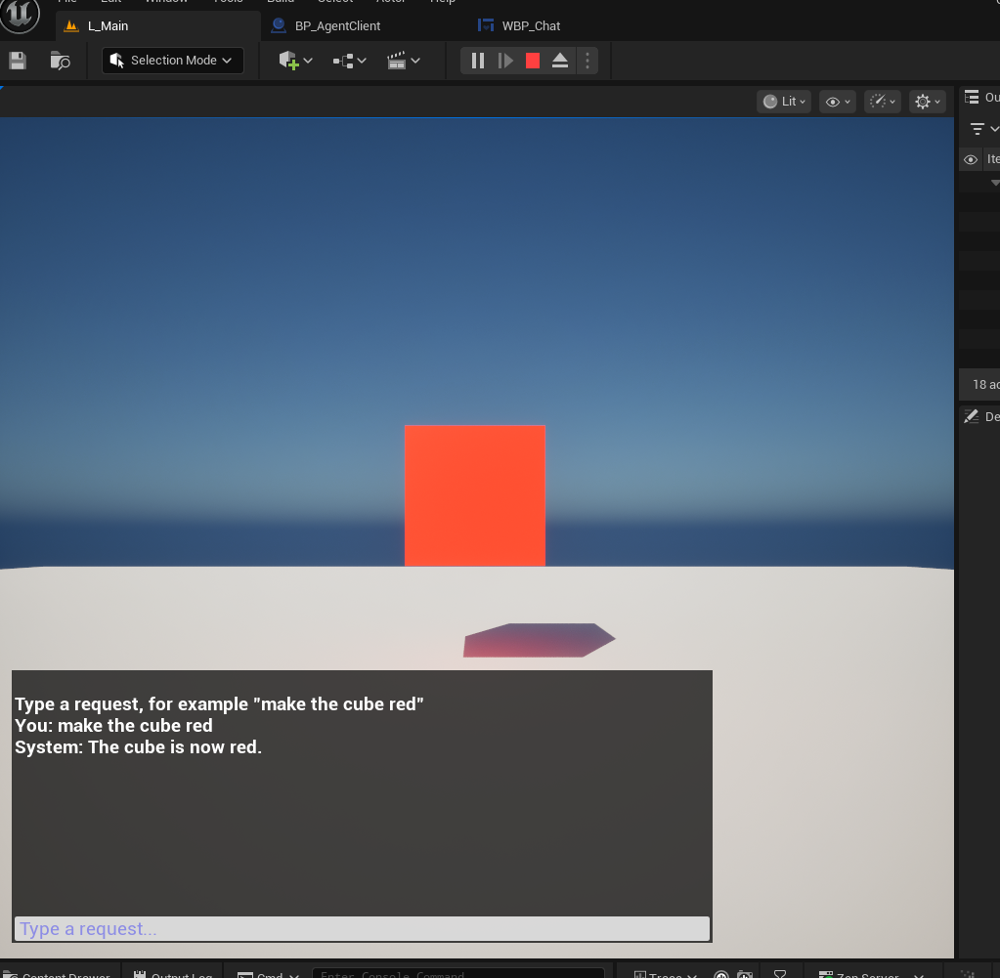
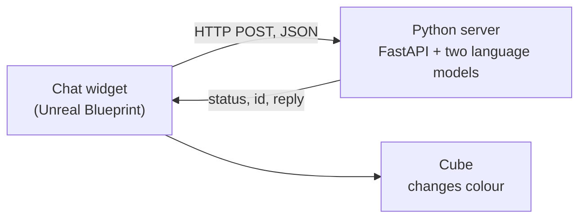

# talk_to_Unreal

A step-by-step tutorial that connects a chat in **Unreal Engine 5.6** to a **Python server**: you type a sentence (`make the cube red`, `rendi il cubo blu`), the server decides which action it asks for, and Unreal carries it out on a 3D cube.



It is a **working base, not a finished project**. It shows one way to connect Unreal to a decision step outside Unreal. It is not enough on its own for a course project, and none of its parts is compulsory: another plugin, another way to decide, another scenario are all fine. See [docs/08-extend.md](docs/08-extend.md).

## What you build



- an Unreal project, `ColorCubeChat`, built from an empty Blank project (Blueprints only, plus one plugin);
- the plugin [VaRestX](https://github.com/AboveConstraints/VaRestX) (MIT) for HTTP and JSON in Blueprints, downloaded from its own repository, not copied here;
- a Python server (`server/`) that maps a sentence to one of four actions, or to none.

## Requirements

- **Unreal Engine 5.6, and only 5.6.** The guide does not apply to other versions.
- A PC that runs the Unreal editor and the Python server together: 16 GB of RAM and a GPU with 6 GB of video memory are the minimum this guide asks for (details and what was measured in [docs/01-prerequisites.md](docs/01-prerequisites.md)).
- About 90 GB of free disk space, Python 3.10 to 3.12, Git, and a C++ toolchain on Windows and macOS (to compile one plugin).
- Internet access once, to download the engine, the plugin, PyTorch and 4.5 GB of models.

## Where to start

Read the chapters in order, starting from [docs/00-overview.md](docs/00-overview.md).

| | Chapter |
|---|---|
| 00 | [Overview](docs/00-overview.md): architecture, versions, minimum PC, conventions |
| 01 | [Prerequisites](docs/01-prerequisites.md) |
| 02 | [The Unreal project](docs/02-unreal-project.md) |
| 03 | [The VaRestX plugin](docs/03-varest-plugin.md) |
| 04 | [The Python server](docs/04-python-server.md) |
| 05 | [HTTP, GET and POST](docs/05-http-get-post.md) |
| 06 | [Blueprints](docs/06-blueprints.md) |
| 07 | [Testing and debugging](docs/07-test-and-debug.md) |
| 08 | [Beyond the base](docs/08-extend.md) |

Chapters 04 and 05 do not need Unreal.

## Repository layout

```text
docs/             the tutorial (docs/media: images; docs/blueprints: graphs as text)
server/           the Python server, its catalog of actions and its evaluation scripts
project-files/    four small files that give the Unreal project an empty C++ module (chapter 03)
```

The Unreal project itself is created in chapter 02, inside the folder where you cloned this repository, and is not stored in Git.

## What was tested

Everything was run end to end on **Linux Mint, Unreal Engine 5.6.0, Python 3.12, NVIDIA RTX 4050 Laptop GPU (6 GB)**. The Windows and macOS instructions follow the documented behaviour of the tools but **have not been run**. If a step fails on those systems, check [chapter 07](docs/07-test-and-debug.md) and open an issue with the exact command and its output.

## How this was written

The text of the guide and the code of the server were written with the help of an AI assistant (Claude, by Anthropic), then run, tested and corrected step by step by the author on the machine described above. Anything not marked as tested may still contain errors.

## Licence

The text, code and files of this repository are under the [MIT licence](LICENSE). VaRestX has its own MIT licence, and the language models the server downloads (`intfloat/multilingual-e5-large`, `BAAI/bge-reranker-v2-m3`) have their own: read them before reusing the models. Unreal Engine is used under Epic's licence.
