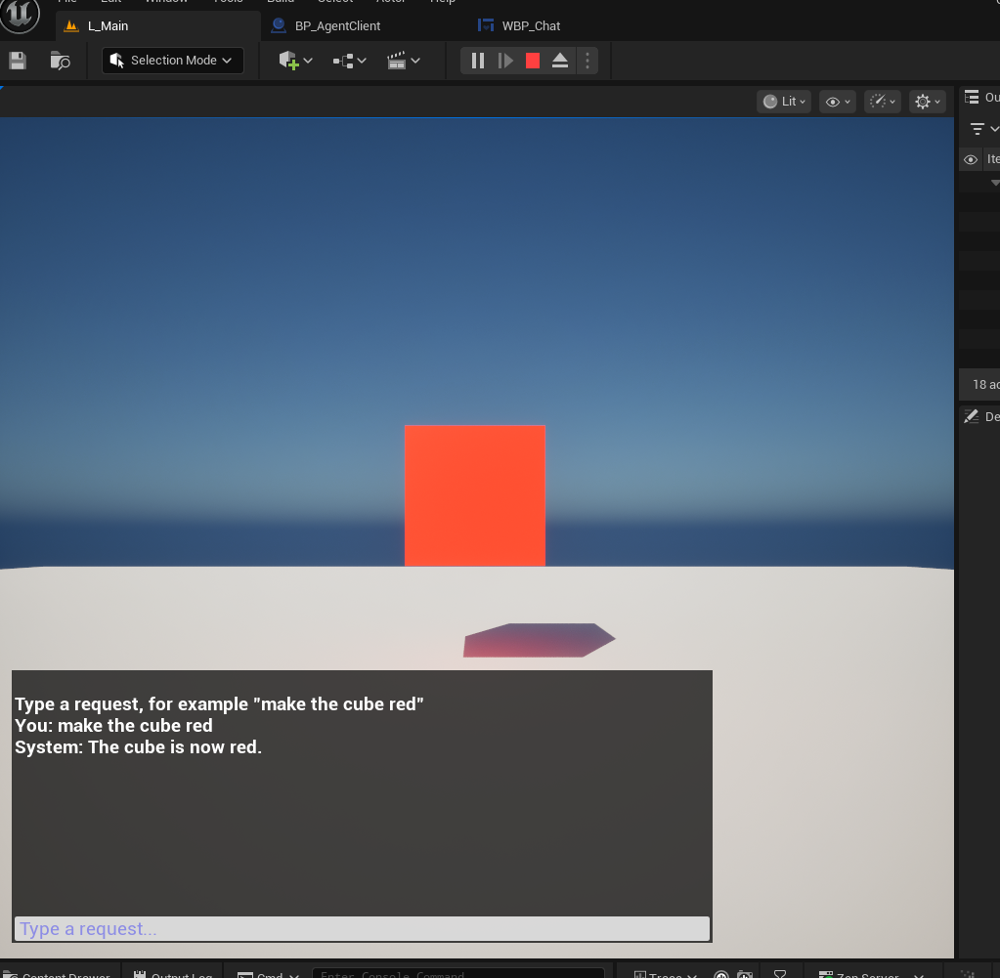
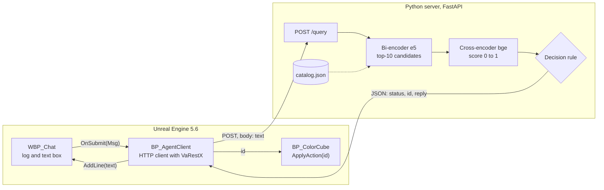
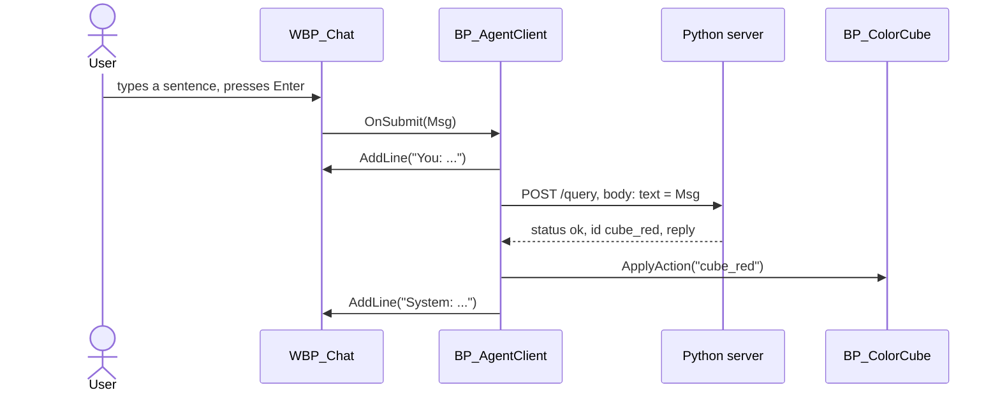

# 00 · Overview

This guide builds, from an empty Unreal Engine project, a minimal natural-language interface to a 3D scene:

1. The user types a sentence in a 2D chat widget (`make the cube red`, `rendi il cubo blu`).
2. Unreal sends the sentence to a local Python server over HTTP (`POST`, JSON).
3. The server decides which of a fixed set of actions the sentence asks for, or that it asks for none, and answers with JSON.
4. Unreal reads the answer, runs the action (changes the colour of a cube) and prints a reply in the chat.

The result is deliberately small. It is a **working base, not a finished project**: on its own it is not enough for the course project, and none of its parts is compulsory (another plugin, another way to decide, another scenario are all fine). See [08 · Beyond the base](08-extend.md).



## Versions and minimum requirements

> **This guide is written for Unreal Engine 5.6, and only for 5.6.** Install exactly that version. It is not written for, and will not work unchanged on, any other version: not 4.27, not 5.0 to 5.5, not 5.7 or later. The editor interface, the node names, the plugin and the pasteable graphs in `docs/blueprints/` all belong to 5.6, and no instructions for adapting to other versions are given.
>
> **A weaker PC is not a reason to change the Unreal version.** The heavy part of the project is the Python server (language models), and it does not depend on the Unreal version. Older Unreal versions would not make it lighter. See [01 · Prerequisites](01-prerequisites.md#hardware) for what to do on a PC below the minimum.

Software versions the guide was run with:

| Component | Version | Note |
|---|---|---|
| Unreal Engine | **5.6** (5.6.0 tested) | Required. |
| VaRestX plugin (third-party) | branch `5.6` of `AboveConstraints/VaRestX`, upstream commit `fd6d2ae` | Pinned to that exact upstream commit. The plugin's authors publish one branch per engine version. The commit belongs to the plugin's repository, not to this one. |
| Python | 3.10 to 3.12 | 3.12.3 tested. |
| PyTorch | current stable build from pytorch.org | 2.14.1 with CUDA 13.0 tested. |
| sentence-transformers, transformers, FastAPI, uvicorn, NumPy | latest at install time (not pinned) | Tested with 6.1.0, 5.18.0, 0.142.2, 0.54.0, 2.5.3. |

Minimum PC to run Unreal Engine 5.6 **and** the server on the same machine (details, sources and measurements in [01](01-prerequisites.md#hardware)):

| | Minimum | Comfortable |
|---|---|---|
| CPU | 64-bit, 4 cores at 2.5 GHz or faster | 8 cores or more |
| RAM | **16 GB** | 32 GB |
| Graphics | A GPU supported by Unreal 5.6 (DirectX 12 on Windows, Vulkan on Linux, Metal on a Mac with Apple Silicon), **6 GB of video memory** | 8 GB or more of video memory; for the server on the GPU, an NVIDIA card |
| Free disk | 90 GB | SSD |
| Internet | Needed once: engine, plugin, PyTorch, 4.5 GB of models | |

## Architecture



Both sides run on the same machine and talk over `http://127.0.0.1:8000`. One exchange, in time order:



| Part | Where | What it does |
|---|---|---|
| `WBP_Chat` | Unreal, UMG widget | Scrolling log and a text box. Raises the event dispatcher `OnSubmit(Msg)` when Enter is pressed. |
| `BP_AgentClient` | Unreal, Actor Blueprint | Creates the widget, builds and sends the HTTP request, routes the answer. The only place that knows about HTTP. |
| `BP_ColorCube` | Unreal, Actor Blueprint | The object being controlled. `ApplyAction(Id)` changes its colour. |
| VaRestX | Unreal, source plugin | Exposes HTTP requests and JSON objects to Blueprints (Unreal has no JSON nodes by default). |
| `server/` | Python | Maps a sentence to an action id. No generative model is involved in the decision. |

## The message contract

The two sides only share this JSON. Everything else can be replaced independently.

Request, `POST http://127.0.0.1:8000/query`, header `Content-Type: application/json`:

```json
{ "text": "make the cube red" }
```

Response when the sentence matches an action:

```json
{
  "status": "ok",
  "id": "cube_red",
  "params": { "color": "red" },
  "reply": "The cube is now red.",
  "score": 0.9999,
  "margin": 0.9903,
  "alternatives": [ { "id": "cube_red", "title": "cube red" }, ... ],
  "timing": { "retrieve_ms": 211.3, "rerank_ms": 30.0 }
}
```

For `ambiguous` and `out_of_scope` the answer has `status`, `score`, `margin`, `alternatives` and `timing`, but no `id`, `params` or `reply`. Unreal branches on `status`.

## Reading order

| Step | Document | Result |
|---|---|---|
| 1 | [01 · Prerequisites](01-prerequisites.md) | Engine, compilers, Python, Git installed. |
| 2 | [02 · The Unreal project](02-unreal-project.md) | Project `ColorCubeChat`: a level with a floor and a white cube whose material has a `Color` parameter. |
| 3 | [03 · The VaRestX plugin](03-varest-plugin.md) | HTTP and JSON nodes available in Blueprints. |
| 4 | [04 · The Python server](04-python-server.md) | Server running on `127.0.0.1:8000`, `/health` answers. |
| 5 | [05 · HTTP, GET and POST](05-http-get-post.md) | You can query the server from the command line and read its answers. |
| 6 | [06 · Blueprints](06-blueprints.md) | The chat widget, the cube logic and the client, wired. |
| 7 | [07 · Testing and debugging](07-test-and-debug.md) | Test sentences, expected results, a table of symptoms and causes. |
| 8 | [08 · Beyond the base](08-extend.md) | What is and is not fixed, ideas, what to do when stuck. |

Steps 4 and 5 do not need Unreal; you can do them before step 2.

## Conventions used in this guide

**Commands for three operating systems.** Every command block is labelled. Run the block for your system.

- **Windows**: Windows PowerShell or PowerShell 7 (not `cmd.exe`).
- **Linux**: bash or zsh.
- **macOS**: zsh (the default shell). Commands are the same as Linux unless a separate block is given.

**Working directory.** Unless stated otherwise, commands run from the root of this repository (the folder that contains `docs/` and `server/`). The Unreal project lives in `ColorCubeChat/` inside it.

**`$UE_ROOT`** is the folder of your Unreal Engine 5.6 installation (see [01](01-prerequisites.md#unreal-engine-56)). Set it once per terminal session.

**Unreal interface.** Names of menus, panels, buttons, nodes and pins appear in **bold** and are the English editor names. Set the editor language to English (Edit → Editor Preferences → Region & Language → Editor Language) before you start; node names in other languages differ. Literal text you type or values you enter appear as `code`.

**Blueprint notation.** In [06](06-blueprints.md):

- *Pin*: a connection point on a node. **Execution pins** are white and set the order in which nodes run. **Data pins** are coloured by type and carry values.
- `wire A → B`: connect pin A to pin B by dragging from one to the other.
- `from A → add Node`: drag a wire from pin A to an empty spot of the graph and release; a search box opens; type the node name and click the result. The new node is created already connected to A. For a node without a starting pin: right-click an empty spot, type the name, click the result.
- *Compile* is the check mark at the top left of a Blueprint editor, *Save* the disk icon next to it. Compile and save at the end of every part. A red error means the part is not finished: read it before going on.

**Screenshots** are in `docs/media/`.

## What was tested

Developed and run end to end on **Linux Mint, Unreal Engine 5.6.0 (Epic's Linux binary), Python 3.12, NVIDIA RTX 4050 Laptop GPU (6 GB)**. The Windows and macOS instructions are written from the engines' documented behaviour and **have not been run by the authors**. If a step fails on those systems, check [07](07-test-and-debug.md) and open an issue with the exact command and its output.
