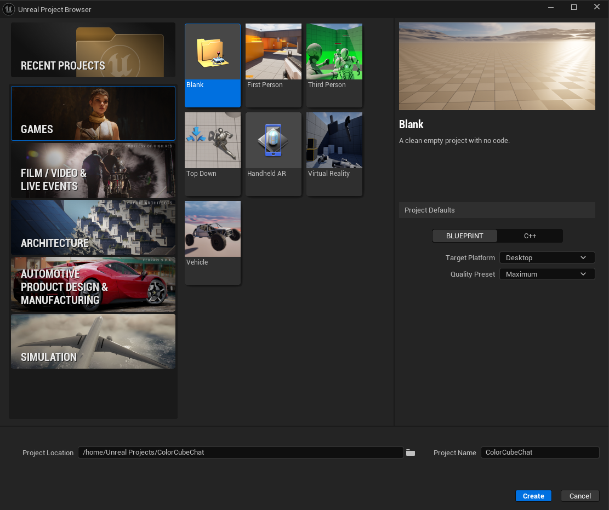
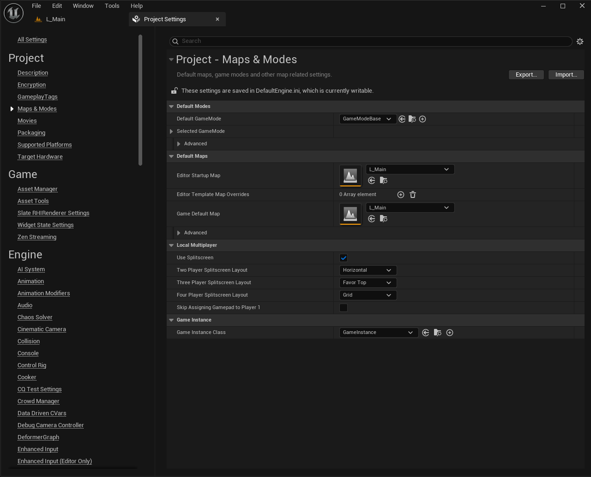
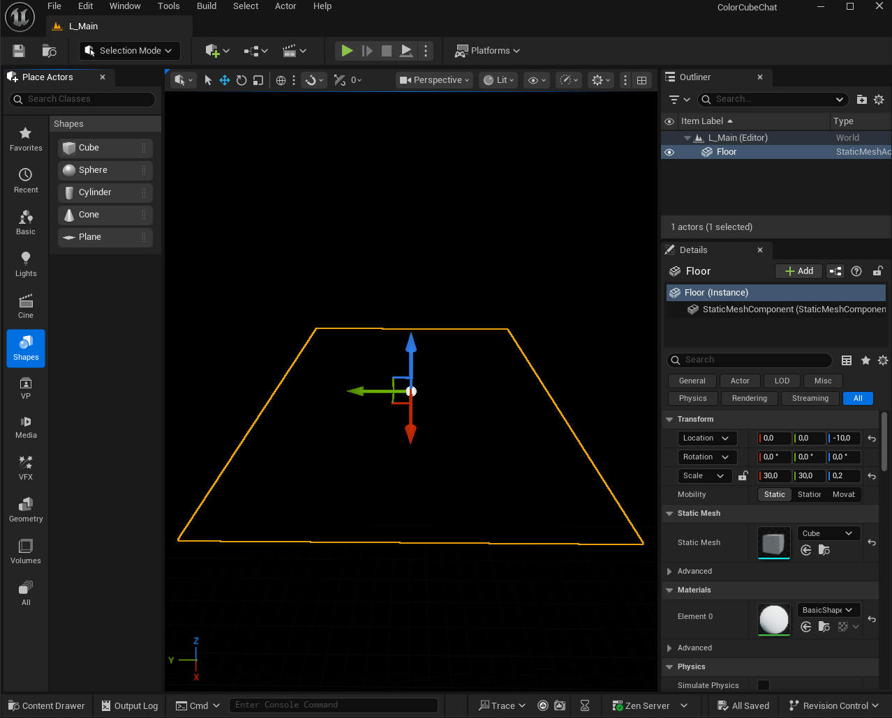
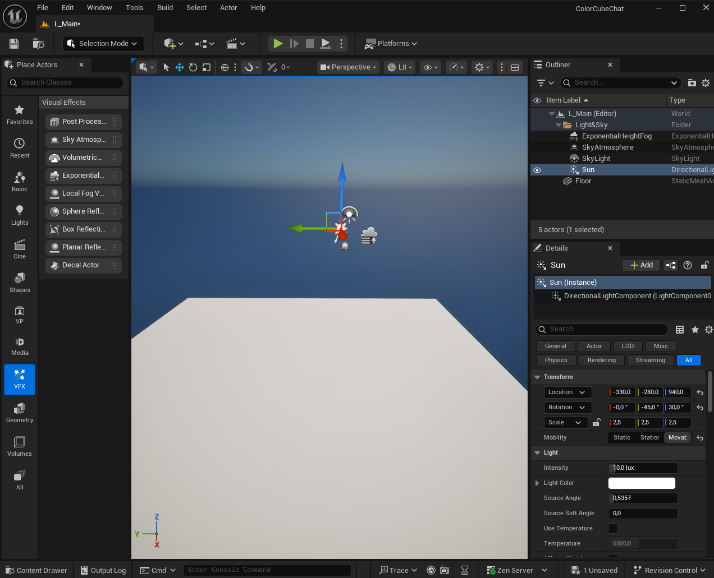
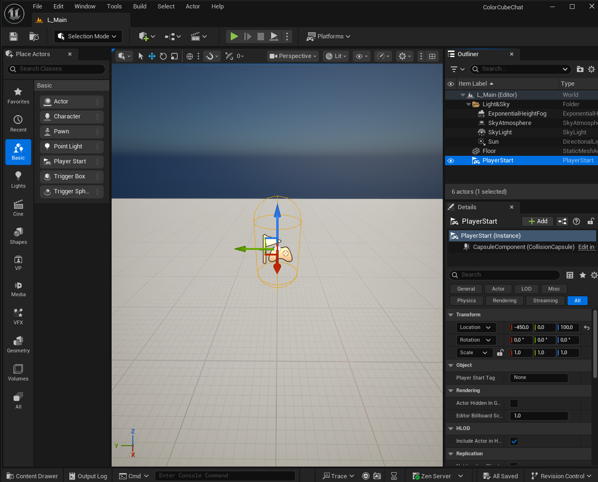
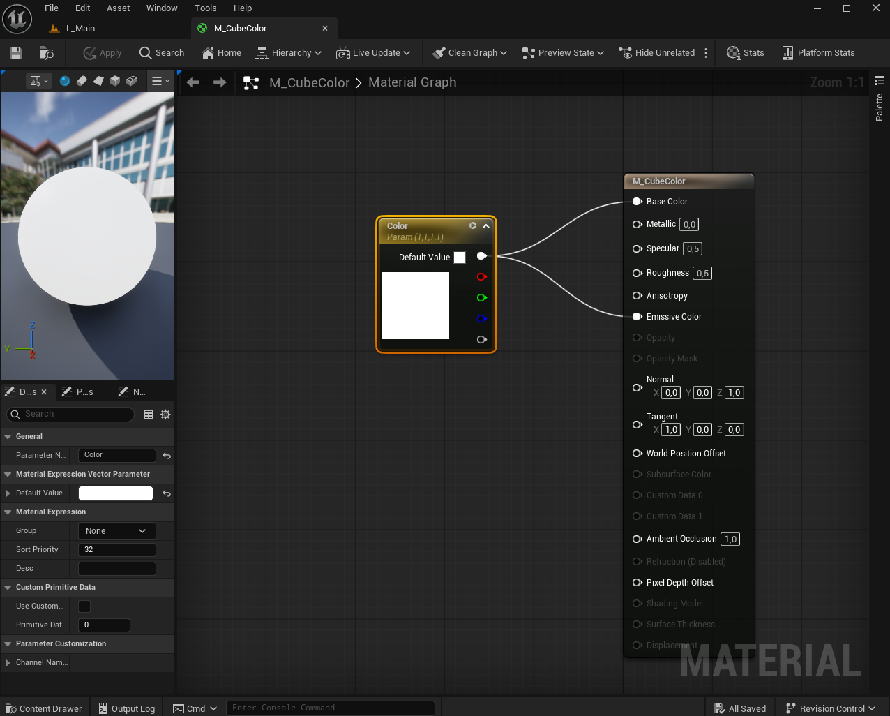
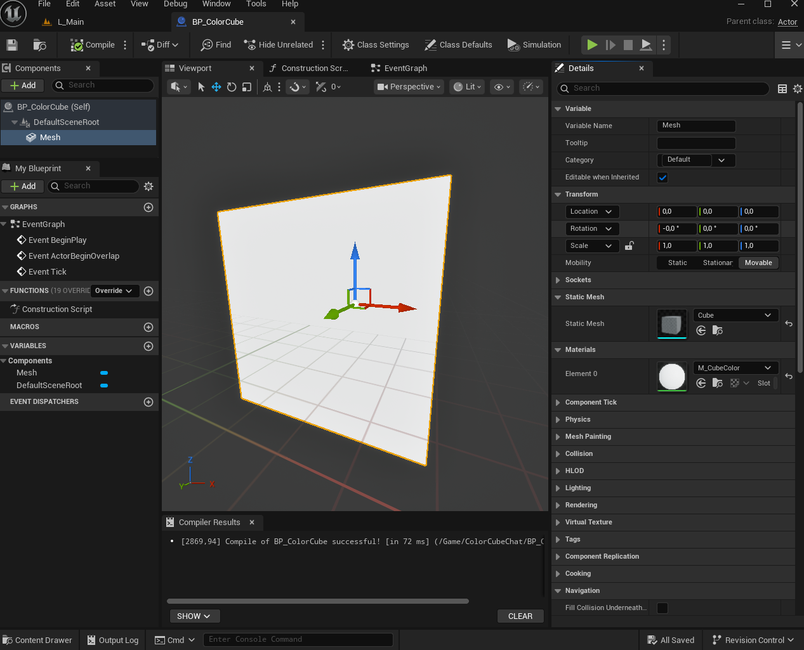
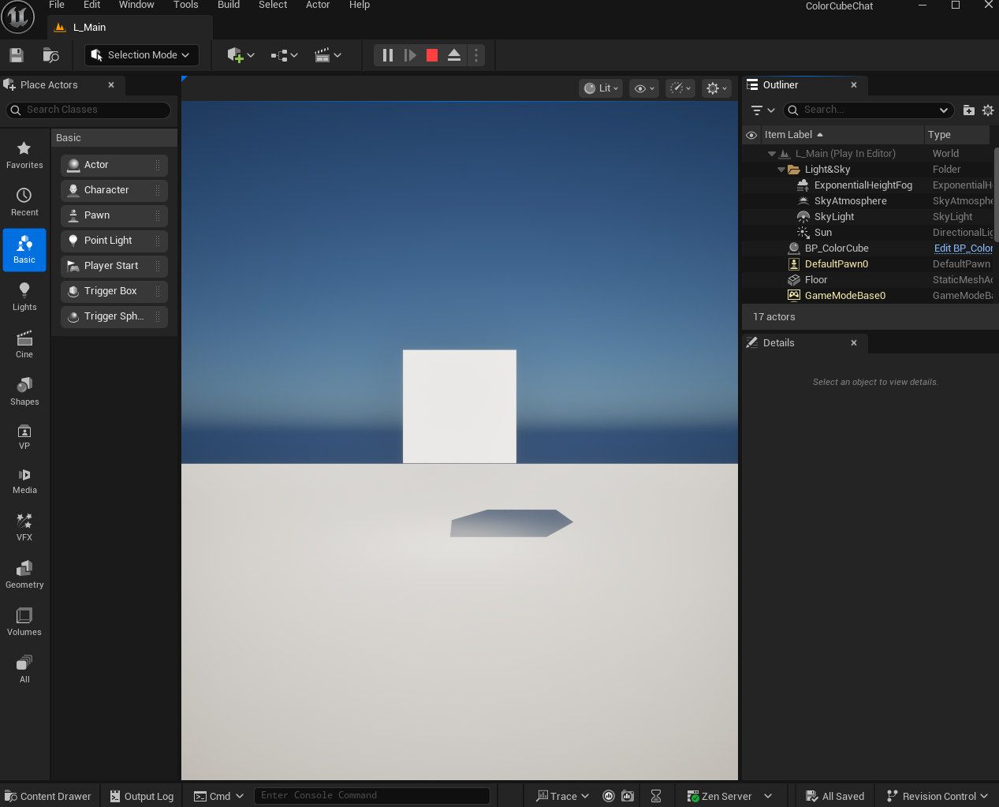

# 02 · The Unreal project

Goal: a project `ColorCubeChat` with a level containing a floor, lights, a player start and one white cube whose colour is driven by a material parameter.

Everything in this document is done in the editor. The Blueprint logic comes later, in [06](06-blueprints.md).

## 2.1 Create the project

1. Start Unreal Engine 5.6 (Epic Games Launcher → Launch on Windows and macOS; run `"$UE_ROOT/Engine/Binaries/Linux/UnrealEditor"` on Linux). The **Unreal Project Browser** opens.
2. In the left list choose **Games**, then the template **Blank** and click **Next**.
3. In **Project Defaults** set:
   - **Blueprint** (not C++);
   - **Target Platform**: **Desktop**;
   - **Quality Preset**: **Maximum** (any preset works).

   If your Project Defaults panel also shows **Starter Content** or **Raytracing**, leave both off.
4. **Project Name**: `ColorCubeChat`.
5. **Project Location**: use the folder button to choose the root folder of this repository (the folder that contains `docs/` and `server/`). The field then shows the full path of the project, `<repository>/ColorCubeChat`. Click **Create**. (The screenshot below shows the default location, not the one you must choose.)

   The rest of the guide assumes the project is in `ColorCubeChat/` inside the repository. If you put it elsewhere, replace that path in the commands of [03](03-varest-plugin.md) and later.

The project now lives in `ColorCubeChat/` (the file `ColorCubeChat/ColorCubeChat.uproject`). The editor opens it; the first start compiles shaders and can take a few minutes.

Set the editor language to English if you have not done it ([01](01-prerequisites.md#editor-language)).

## 2.2 Folder structure

Everything you create goes under one folder so that it is easy to move or delete.

1. In the **Content Browser** (bottom of the window; open it with **Window → Content Browser → Content Browser 1** if it is hidden) select the root folder **Content**.
2. Right-click an empty area → **New Folder** → name it `ColorCubeChat` → Enter.

All assets below are created inside `Content/ColorCubeChat`. Open the folder (double-click) before each *right-click → …* in the Content Browser.

## 2.3 The level

1. **File → New Level**. If a dialog offers templates, choose the one that gives an **empty level**. The new level is empty: the **Outliner** (top right) lists no actors. Everything it needs is added in 2.4.
2. **File → Save Current Level As…**. Navigate to `Content/ColorCubeChat`, name it `L_Main`, click **Save**.
3. Make it the level the project opens: **Edit → Project Settings → Project → Maps & Modes**. Set **Editor Startup Map** and **Game Default Map** to `L_Main` (click the drop-down and pick it).

In **Maps & Modes** also check **Default GameMode**: if it is `None` or `GameModeBase`, no change is needed. With these settings the engine spawns a `DefaultPawn` (a flying free camera) at the **Player Start** you add below. That pawn is the view of the player; you will not move it in this project because the chat takes the input.

## 2.4 Fill the level

The level needs a floor, light, a sky with a soft horizon, and a place where the player starts. Use the **Place Actors** panel: **Window → Place Actors** (it opens on the left). It groups actors in categories, shown as icons on its left edge (Basic, Lights, Shapes, **VFX** for visual effects, …); if you do not find an actor, type its name in the search box at the top of the panel. Drag an actor from the panel into the viewport, then set its values in **Details** → **Transform** (select the actor first). Rename each actor in the Outliner (select it, press F2). Values are in Unreal units (1 unit = 1 cm).

**Floor**

1. Place Actors → **Shapes** → **Cube**, drag into the viewport. Rename it `Floor`.
2. Transform: **Location** `(0, 0, -10)`; **Scale** `(30, 30, 0.2)`. To give the three scale values different numbers, first click the padlock icon next to **Scale** (it keeps them equal while locked). The floor is a slab 30 m × 30 m × 20 cm whose top face is at Z = 0. The player never moves, so the far edge of the floor is only seen as the line of the horizon.

**Light and sky**

3. Place Actors → **Lights** → **Directional Light**. Rename it `Sun`. Transform: **Rotation** `(0, -45, 30)` (X = roll, Y = pitch, Z = yaw); **Mobility** **Movable**.
4. Place Actors → **VFX** → **Sky Atmosphere**. Leave the defaults.
5. Place Actors → **Lights** → **Sky Light**. Transform: **Mobility** **Movable**. In **Details** → **Light** tick **Real Time Capture**.
6. Place Actors → **VFX** → **Exponential Height Fog**. Leave the defaults. The fog brightens the distant floor towards the colour of the sky, so the far part of the floor fades towards the horizon instead of ending against a black void.

A faint line where the floor ends is expected: the fog softens it but does not hide it. To remove it completely, make the floor larger (for example Scale `(300, 300, 0.2)`). If the area beyond the floor is black instead of sky-coloured, check that the `Sun` exists and that **Atmosphere Sun Light** is ticked in its **Details** (section *Atmosphere and Cloud*), that `SkyAtmosphere` is in the Outliner, and increase the fog by raising **Fog Density** in the `ExponentialHeightFog` Details.

**Where the player starts**

7. Place Actors → **Basic** → **Player Start**, drag into the viewport. Transform: **Location** `(-450, 0, 100)`, **Rotation** `(0, 0, 0)`. The arrow of the Player Start points along +X: that is the viewing direction, towards the cube you place in 2.7. The camera of the player sits at about eye height above this point, so Z = 100 puts it roughly level with the cube (centre at Z = 130).

**Save the level**: **File → Save Current Level** (Ctrl+S).

**Tip:** to keep the Outliner tidy, select `Sun`, `SkyAtmosphere`, `SkyLight` and `ExponentialHeightFog`, click the **Create Folder** icon at the top right of the Outliner, and name the folder `Light&Sky`. Folders only organise the Outliner; they have no effect on the game. The screenshots in this chapter show the actors grouped this way.

The Outliner now lists `Floor`, `Sun`, `SkyAtmosphere`, `SkyLight`, `ExponentialHeightFog` and `PlayerStart` (the first four inside the folder, if you made it). A grey floor lit by a sun, fading into the sky at the horizon, is visible in the viewport.

## 2.5 The material with a colour parameter

The cube's colour will be changed at run time by setting a *vector parameter* on a copy of this material.

1. Content Browser → `Content/ColorCubeChat` → right-click → **Material** → name it `M_CubeColor`. Double-click to open the Material Editor.
2. Right-click an empty spot of the graph → type `VectorParameter` → click **VectorParameter**. A node with a colour swatch appears.
3. Select the node. In the **Details** panel:
   - **Parameter Name**: `Color` (capital C: the Blueprint will use exactly this name);
   - **Default Value**: click the colour swatch and set R 1, G 1, B 1, A 1 (white), then close the picker.
4. Wire the node's top output pin (RGB) to **Base Color** on the main material node. Wire the same output pin also to **Emissive Color**. (The emissive input makes the colour visible even where the lighting is dark, which keeps the demo readable on weak hardware.)
5. Click **Apply** (toolbar) and then **Save**. Close the Material Editor.

## 2.6 The cube Blueprint

1. Content Browser → `Content/ColorCubeChat` → right-click → **Blueprint Class** → **Actor** → name it `BP_ColorCube`. Double-click to open it.
2. In the **Components** panel (top left) click **+ Add** → **Shapes** → **Cube** (or type `Cube` in the search box of the menu). A component named *Cube* appears under *DefaultSceneRoot*, already using the engine's 1 m cube mesh. Press F2 and rename it `Mesh` (the Blueprint steps in [06](06-blueprints.md) refer to it by this name).
3. Select `Mesh`. In **Details** → **Static Mesh** the mesh is already **Cube**.
4. **Details** → **Materials** → **Element 0** → choose `M_CubeColor`.
5. **Compile** and **Save**. The Viewport tab of the Blueprint shows a white cube. Close the Blueprint editor.

## 2.7 Place the cube in the level

1. Drag `BP_ColorCube` from the Content Browser into the level viewport. Drop it anywhere.
2. Select it in the **Outliner**. In **Details** → **Transform** set **Location** `(0, 0, 130)`. The cube is 4.5 m in front of the Player Start (which is at X = -450) and floats 80 cm above the floor (its centre is at 130 and it is 100 cm tall).
3. **File → Save Current Level** (Ctrl+S).

Test: press **Play** (the green triangle in the toolbar). You should see a white cube floating in front of you, roughly in the middle of the view, above a grey floor. If it is much too high or too low, change the **Z** of the Player Start in 2.4. Stop with **Esc** (if the mouse is captured and Esc does not respond, use **Shift+F1**).

## Checkpoint

- `Content/ColorCubeChat` contains `L_Main`, `M_CubeColor`, `BP_ColorCube`.
- The Outliner of `L_Main` lists `Floor`, `Sun`, `SkyAtmosphere`, `SkyLight`, `ExponentialHeightFog`, `PlayerStart` and `BP_ColorCube`.
- The cube is white in Play.
- No errors in the Blueprint (green check on Compile).

Next: [03 · The VaRestX plugin](03-varest-plugin.md). Close the editor first.
