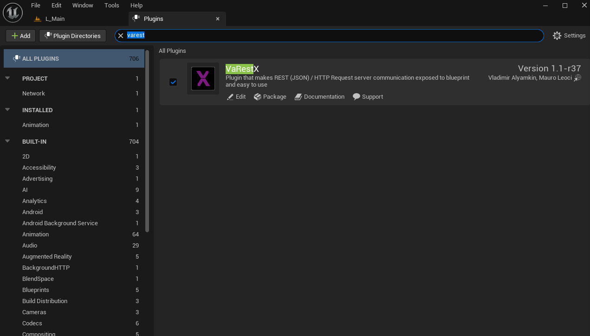

# 03 · The VaRestX plugin

Unreal Engine does not expose HTTP requests or JSON objects to Blueprints in a usable way. **VaRestX** is an MIT-licensed plugin that does: it adds nodes such as *Construct Json Request*, *Set String Field*, *Process URL* and the events *On Request Complete* / *On Request Fail*.

The plugin is distributed as source code, so it has to be **compiled once** for your machine and engine version. This chapter does that in five steps:

| Step | What | Result |
|---|---|---|
| 3.1 | Download the plugin source into the project | `ColorCubeChat/Plugins/VaRestX/` |
| 3.2 | Add a small, empty C++ module to the project | `ColorCubeChat/Source/…` |
| 3.3 | Declare the plugin and the module in the project file | edited `ColorCubeChat.uproject` |
| 3.4 | Compile, from the command line | `Result: Succeeded` |
| 3.5 | Open the project and check that the plugin is there | the node *Construct Json Request* exists |

## What is pinned

| | |
|---|---|
| Repository | <https://github.com/AboveConstraints/VaRestX> |
| Branch | `5.6` |
| Commit | `fd6d2ae` (a commit of the plugin's own repository, not of this one; it fixes the exact plugin source the guide was run with) |
| Licence | MIT (the plugin folder contains `LICENSE`) |

Other plugins with a similar name do not fit: the Fab "VaRest" listing is Windows-only, `Vengaunt/VaRest` has only a `develop` branch and `ufna/VaRest` is archived at an older engine version.

## How the build is run, and why the project needs a module

The compile command of 3.4 uses the option **`-NoEngineChanges`**. It tells Unreal's build tool to compile only files that belong to your project, and to stop with an error rather than modify any file of your Unreal Engine installation. The engine is shared by all your projects, so this is the safe setting, and it stays on.

With that option, a project that contains only Blueprints and content cannot be built. The build tool gives such a project no target of its own and falls back to a generic editor target that contains every engine plugin. For some of those plugins (MetaHuman, Capture Manager) the engine installation lacks the intermediate build files, so the tool would have to rebuild engine modules, which the option forbids. The build then ends with:

```
Result: Failed (FailedDueToEngineChange)
```

The solution, in 3.2, is to give the project a small module of its own, with no code in it. The build tool then builds a target specific to the project, `ColorCubeChatEditor`, which contains only the plugins the project enables. No engine module has to be rebuilt, and the option is no obstacle. For everything else the project remains what it was: Blueprints and content.

This was found and tested on Linux. On Windows and macOS it is not known whether the module is necessary; it is harmless there.

## Before you start

1. **Close the Unreal editor.**
2. **Go to the repository root**, the folder that contains `docs/`, `server/`, `project-files/` and `ColorCubeChat/`. All commands of this chapter run from there, and **not** from inside `ColorCubeChat/`. Check:

   ```bash
   ls
   ```

   (on Windows PowerShell `dir`). The listing must show `docs`, `server`, `project-files` and `ColorCubeChat`. If it shows `ColorCubeChat.uproject`, `Content` and `Config`, you are inside the project: go up one level with `cd ..`.
3. **Check that `$UE_ROOT` is set in this terminal** (a new terminal window starts without it):

   ```bash
   echo "$UE_ROOT"
   ```

   It must print the folder of your Unreal Engine installation. If it prints an empty line, set it as described in [01](01-prerequisites.md#unreal-engine-56). An empty `$UE_ROOT` turns the build command of 3.4 into `/Engine/Build/...` and fails with *No such file or directory*.

## 3.1 Get the plugin source

**Windows (PowerShell), Linux, macOS** (identical):

```bash
git clone --branch 5.6 https://github.com/AboveConstraints/VaRestX.git ColorCubeChat/Plugins/VaRestX
git -C ColorCubeChat/Plugins/VaRestX checkout fd6d2ae
```

`git clone` creates the `Plugins` folder if it does not exist. Remove the plugin's own Git metadata, so that the project folder is plain files (the project is later packed into a zip):

**Windows (PowerShell)**

```powershell
Remove-Item -Recurse -Force ColorCubeChat\Plugins\VaRestX\.git
```

**Linux, macOS**

```bash
rm -rf ColorCubeChat/Plugins/VaRestX/.git
```

The folder `ColorCubeChat/Plugins/VaRestX/` (inside the project folder, not `ColorCubeChat/ColorCubeChat/…`) now contains `VaRestX.uplugin`, `Source/`, `Config/`, `LICENSE`, `README.md`.

## 3.2 Add an empty C++ module to the project

The four small files that make up the module are already in this repository, in the folder `project-files/Source/`. You copy that folder **into the Unreal project folder** `ColorCubeChat/`, the one that contains `ColorCubeChat.uproject`, so that it ends up next to `Content/` and `Config/`.

Before the copy, the two folders look like this (the repository root is the folder where you are):

```
repository root/
├── project-files/
│   └── Source/              ← the folder to copy
└── ColorCubeChat/           ← the Unreal project: the destination
    ├── ColorCubeChat.uproject
    ├── Config/
    ├── Content/
    └── Plugins/
```

After the copy, `Source/` is inside `ColorCubeChat/`:

```
repository root/
└── ColorCubeChat/
    ├── ColorCubeChat.uproject
    ├── Config/
    ├── Content/
    ├── Plugins/
    └── Source/              ← new
```

The command copies the `Source` folder itself, so do not create a `Source` folder yourself beforehand. Run it from the repository root:

**Windows (PowerShell)**

```powershell
Copy-Item -Recurse project-files\Source ColorCubeChat\
```

**Linux, macOS**

```bash
cp -r project-files/Source ColorCubeChat/
```

You can also do it with the file manager: copy the folder `project-files/Source` and paste it inside `ColorCubeChat/`.

Check the result: the project folder must now contain these four files (and nothing like `ColorCubeChat/Source/Source/`):

```
ColorCubeChat/Source/ColorCubeChat.Target.cs
ColorCubeChat/Source/ColorCubeChatEditor.Target.cs
ColorCubeChat/Source/ColorCubeChat/ColorCubeChat.Build.cs
ColorCubeChat/Source/ColorCubeChat/ColorCubeChat.cpp
```

(on Linux or macOS: `find ColorCubeChat/Source -type f`; on Windows PowerShell: `Get-ChildItem -Recurse -File ColorCubeChat\Source`).

The two `.Target.cs` files define the build targets of the project, `Build.cs` lists what the module depends on (only the engine's `Core` module), and `ColorCubeChat.cpp` registers the module and contains no code of its own.

The files carry the project name. If you used another project name in [02](02-unreal-project.md), rename the files and replace the name inside them.

## 3.3 Declare the plugin and the module in the project file

Open `ColorCubeChat/ColorCubeChat.uproject` in a text editor and make two changes.

1. Add this object to the `Plugins` array:

   ```json
   {
       "Name": "VaRestX",
       "Enabled": true
   }
   ```

2. Add a `Modules` array at the same level as `Plugins`:

   ```json
   "Modules": [
       {
           "Name": "ColorCubeChat",
           "Type": "Runtime",
           "LoadingPhase": "Default"
       }
   ]
   ```

**Remember the commas.** Objects in a JSON array are separated by commas, and so are the top-level blocks of the file. Put a comma after the closing brace or bracket of the entry that comes before yours, and none after the last one. The finished file of a Blank project looks like this (your `Plugins` array may list other plugins than `ModelingToolsEditorMode`; leave them as they are):

```json
{
    "FileVersion": 3,
    "EngineAssociation": "5.6",
    "Category": "",
    "Description": "",
    "Modules": [
        {
            "Name": "ColorCubeChat",
            "Type": "Runtime",
            "LoadingPhase": "Default"
        }
    ],
    "Plugins": [
        {
            "Name": "ModelingToolsEditorMode",
            "Enabled": true,
            "TargetAllowList": [
                "Editor"
            ]
        },
        {
            "Name": "VaRestX",
            "Enabled": true
        }
    ]
}
```

If the file has no `Plugins` array, add `"Plugins": [ ... ]` containing only the VaRestX object, with no comma inside it.

A missing or an extra comma makes the file invalid and the project will not open. To check the file before you go on, paste it into a JSON validator, or run `python3 -m json.tool ColorCubeChat/ColorCubeChat.uproject` (on Windows `py -3 -m json.tool ColorCubeChat\ColorCubeChat.uproject`): it prints the file back if it is valid and names the line of the error if not.

## 3.4 Compile

Run the command for your system from the repository root (see *Before you start*). It builds the editor target of the project, including the plugin, without opening the editor.

**Linux** (tested; about 1 minute on a fresh project)

```bash
"$UE_ROOT/Engine/Build/BatchFiles/Linux/Build.sh" Development Linux -Project="$PWD/ColorCubeChat/ColorCubeChat.uproject" -TargetType=Editor -Progress -NoEngineChanges -NoHotReloadFromIDE
```

**Windows (PowerShell)** (not yet tested by the authors)

```powershell
& "$UE_ROOT\Engine\Build\BatchFiles\Build.bat" Development Win64 -Project="$PWD\ColorCubeChat\ColorCubeChat.uproject" -TargetType=Editor -Progress -NoEngineChanges -NoHotReloadFromIDE
```

**macOS** (not yet tested by the authors)

```bash
"$UE_ROOT/Engine/Build/BatchFiles/Mac/Build.sh" Development Mac -Project="$PWD/ColorCubeChat/ColorCubeChat.uproject" -TargetType=Editor -Progress -NoEngineChanges -NoHotReloadFromIDE
```

Expected:

- the build announces the project-specific target: `Building UnrealEditor - ColorCubeChatEditor - Linux - Development`;
- the output ends with `Result: Succeeded`;
- the folders `ColorCubeChat/Binaries/` and `ColorCubeChat/Plugins/VaRestX/Binaries/` now exist.

A warning that `VaRest.Build.cs` references a non-existent `Source/VaRestX/Private` folder is harmless.

**If the build fails:**

- `Result: Failed (FailedDueToEngineChange)`, with a list of files of `MetaHuman` or `CaptureData` inside the engine folder: the project has no module of its own. Repeat 3.2 and 3.3, and check that the build announces `ColorCubeChatEditor` and not `UnrealEditor`.
- *No such file or directory* for a path starting with `/Engine/`: `$UE_ROOT` is empty (see *Before you start*).
- Any other failure: the first error line of the output names the missing component (for example a Windows SDK or an Xcode licence). Install it and run the command again.

**Alternative on Windows and macOS** (not tested). Instead of the command, open `ColorCubeChat.uproject` (double-click on Windows; on macOS, right-click → Open With → Unreal Editor, or start the editor from the Launcher and use **More → Browse**). The editor reports that modules are missing or out of date and asks whether to rebuild: click **Yes** and wait. On Linux this does not work: the editor only reports that the modules are out of date and tells you to compile them with your IDE. Use the command above.

## 3.5 Open the project and check the plugin

The plugin is already enabled: you did it in the project file in 3.3, which is exactly what the checkbox in the editor does. So here you only **open the project and check** that the plugin is loaded. Nothing has to be ticked, unless you find it switched off.

Open the project the way you usually do. Windows and macOS: double-click `ColorCubeChat.uproject`, or open it from the Epic Games Launcher. Linux has no Launcher, so open it from the terminal with the editor program (you can also use the *Recent projects* list of the editor's start window afterwards):

```bash
"$UE_ROOT/Engine/Binaries/Linux/UnrealEditor" "$PWD/ColorCubeChat/ColorCubeChat.uproject"
```

Then check two things in the editor:

1. **Edit → Plugins**, type `VaRest` in the search box. **VaRestX** (category *Network*) must be listed with its box ticked. If it is not ticked, tick it and restart the editor when it asks.
2. Open `BP_ColorCube` → **Event Graph** and right-click an empty spot. In the menu that opens, **untick *Context Sensitive*** (the checkbox at the top right of the menu), then type `Construct Json Request` in the search box. The node must be in the list. Close the menu with Esc.

   With *Context Sensitive* ticked, which is the default, the menu only lists the nodes that fit the place where you clicked. `Construct Json Request` is not one of them, so it can be missing even though the plugin is loaded. This is the search filter, not an error of yours. *Context Sensitive* stays unticked until you tick it again; you may want to leave it that way while following [06](06-blueprints.md) or tick it again afterwards.



If the node is missing even with *Context Sensitive* unticked: the plugin did not compile (repeat 3.4 and read the output), it is not enabled (3.3), or the engine version is not 5.6.

## A known defect: do not branch on *Get Status*

On Unreal 5.6, VaRestX's *Get Status* node reports a successful request as `Failed_ConnectionError`. The plugin casts the engine's request status into its own enum, which has one extra value. This guide therefore **never** reads *Get Status*. The outcome is read from the two events that VaRestX raises: **On Request Complete** (an HTTP answer arrived) and **On Request Fail** (no answer: connection refused, timeout).

Next: [04 · The Python server](04-python-server.md).
