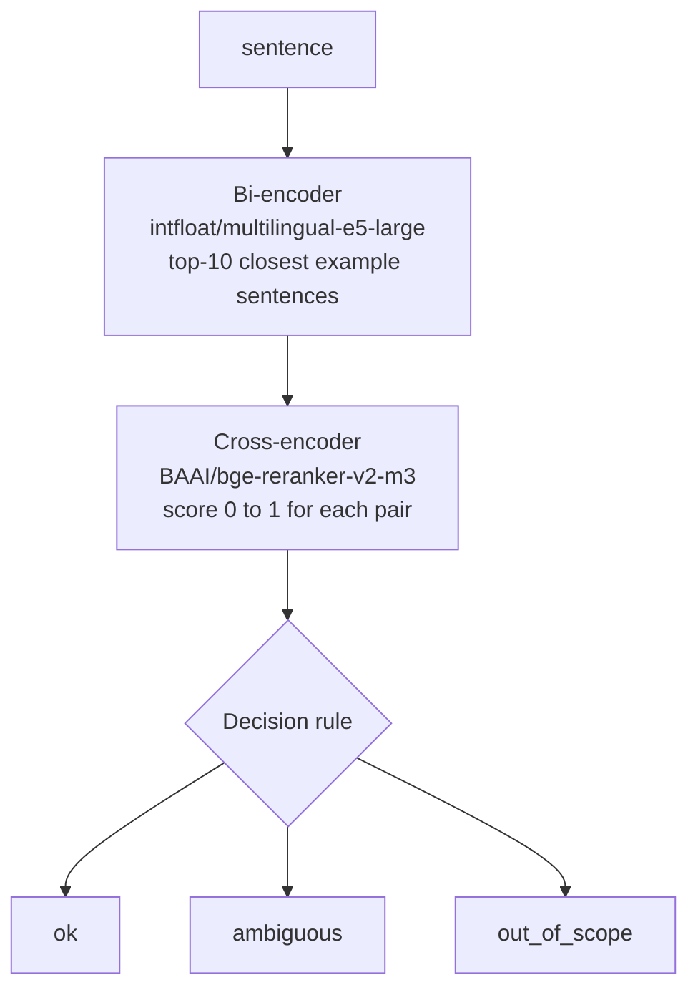

# 04 · The Python server

The server is a small FastAPI application (`server/server.py`) that maps a sentence to an action. It needs no Unreal Engine, so you can run it before or after the project.

## 4.1 What it does

No generative model is in the decision path. The server does a two-stage retrieval over a hand-written catalog, then applies a threshold rule.



- A **bi-encoder** embeds the query and each catalog sentence *separately* into vectors and compares them by cosine similarity. The catalog vectors are computed once, at start-up. It is fast but coarse; e5 cosine similarities sit between 0.7 and 1.0 by design, so they cannot serve as a refusal threshold.
- A **cross-encoder** reads the query and one candidate *together* and outputs a relevance score. It is slower and more accurate, so it only re-scores the 10 candidates from the first stage. Its 0–1 score is what the decision rule uses.
- Both models are multilingual: the catalog has English and Italian example sentences, and queries in either language work. e5 requires the prefixes `query: ` and `passage: ` on its inputs; `server.py` adds them.

**Decision rule** (`T_ACCEPT` = 0.4, `MARGIN` = 0.05, both environment variables):

| Condition | `status` |
|---|---|
| best score `< T_ACCEPT` | `out_of_scope` |
| best score `≥ T_ACCEPT` and gap between best and second-best action `< MARGIN` | `ambiguous` |
| otherwise | `ok` |

The two values are not tuned on this catalog. If numbers matter in your project, tune them on a development split that is separate from your test set.

**The catalog** (`server/catalog/catalog.json`) has one entry per action:

```json
{
  "id": "cube_red",
  "title": "cube red",
  "descriptions": ["make the cube red", "paint the cube red", "rendi il cubo rosso", "..."],
  "params": { "color": "red" },
  "reply": "The cube is now red."
}
```

There are four entries (`cube_red`, `cube_green`, `cube_blue`, `cube_white`) with six descriptions each. Adding an action means adding an entry here and a branch in the Blueprint (see [08](08-extend.md)).

## 4.2 Install

From the repository root. This creates a virtual environment in `.venv/`, which is ignored by Git.

**Windows (PowerShell)**

```powershell
py -3.12 -m venv .venv
.\.venv\Scripts\Activate.ps1
```

If PowerShell refuses to run the script (*running scripts is disabled*), allow it for this window only and repeat the second line:

```powershell
Set-ExecutionPolicy -Scope Process -ExecutionPolicy Bypass
```

**Linux, macOS**

```bash
python3 -m venv .venv
source .venv/bin/activate
```

The prompt now starts with `(.venv)`. Every command below runs in a terminal where the environment is active.

### Install PyTorch

PyTorch comes in different builds for different hardware, so it is installed **first and on its own**. If you let `pip` pull it in as a dependency of the other packages, it chooses a build for you, which may not match your machine.

**1. Decide which build you need**

| Your machine | Build to choose |
|---|---|
| Windows or Linux with an **NVIDIA** graphics card | A **CUDA** build. The server then runs on the GPU. |
| Windows or Linux with an AMD or Intel graphics card, or none | The **CPU** build. Slower (about 0.6 s per query instead of 35 ms), works the same. |
| macOS | The standard build (there is no CUDA on a Mac). The server runs on the CPU. |

**2. For a CUDA build, find the CUDA version your driver supports.** Run `nvidia-smi` in a terminal and read **CUDA Version** at the top right of the table (for example `CUDA Version: 13.0`). It is the highest CUDA version your driver can run. Choose that version, or a lower one, among the options offered at <https://pytorch.org/get-started/locally/>. If `nvidia-smi` is not found, you have no working NVIDIA driver: use the CPU build.

**3. Get the exact command** from that page: *Stable*, your OS, *Pip*, *Python*, and the compute platform you decided on. The page shows the command to run. Its version numbers change over time, so the page is the reference. The commands below only show the pattern.

**The machine this guide was run on**

Linux, NVIDIA RTX 4050 Laptop GPU, driver 580, `nvidia-smi` reports `CUDA Version: 13.0`. So the CUDA 13.0 build was chosen, with:

```bash
pip install torch --index-url https://download.pytorch.org/whl/cu130
```

`cu130` means CUDA 13.0. This is the part you change for your machine:

| If you have | Replace the part after `--index-url` with | Full command |
|---|---|---|
| NVIDIA, `nvidia-smi` says 13.0 (like the authors) | `https://download.pytorch.org/whl/cu130` | `pip install torch --index-url https://download.pytorch.org/whl/cu130` |
| NVIDIA, another CUDA version | `.../whl/cuXYZ`, with `XYZ` the version without the dot (12.8 becomes `cu128`) **if the selector lists it** | the command shown by the selector |
| No NVIDIA card (Windows, Linux) | `https://download.pytorch.org/whl/cpu` | `pip install torch --index-url https://download.pytorch.org/whl/cpu` |
| macOS | nothing | `pip install torch` |

The same command is typed on Windows PowerShell, Linux and macOS (after the virtual environment is active). The download is several GB for a CUDA build.

**4. Check the result**

```bash
python -c "import torch; print(torch.__version__, 'cuda:', torch.cuda.is_available())"
```

- NVIDIA card: the output must contain `cuda: True`. The version ends in the build you chose (`+cu130` for the authors).
- CPU or macOS: `cuda: False` is correct. The server uses the CPU.

If you have an NVIDIA card and see `cuda: False`, the usual causes are: the CPU build got installed (the version ends in `+cpu`), the driver is older than the CUDA version you chose, or the virtual environment is not the active one (`echo "$VIRTUAL_ENV"`, on Windows `echo $env:VIRTUAL_ENV`, must end with `.venv`). To replace a wrong build: `pip uninstall torch`, then run the right command again.

### Install the other packages

With PyTorch in place, install the rest (`sentence-transformers`, `fastapi`, `uvicorn`, `numpy`):

```bash
pip install -r server/requirements.txt
```

## 4.3 Start the server

```bash
cd server
python -m uvicorn server:app --host 127.0.0.1 --port 8000
```

- The **first** start downloads the two models from Hugging Face (about 4.5 GB: 2.2 GB + 2.3 GB, cached in your user profile, in `~/.cache/huggingface` on Linux and macOS and `%USERPROFILE%\.cache\huggingface` on Windows). It takes as long as your connection needs.
- Every later start loads them from the cache in about a minute. Wait for the line `Application startup complete.` before you test.
- **Leave this terminal open and visible.** Every request appears in it as a line like `POST /query HTTP/1.1" 200 OK`; that line is your proof that a request reached the server.
- Stop the server with **Ctrl+C**.
- `127.0.0.1` is used instead of `localhost` so that the name cannot resolve to the IPv6 address `::1` while the server listens on IPv4 only.

Optional environment variables (set them in the terminal before starting):

| Variable | Default | Meaning |
|---|---|---|
| `T_ACCEPT` | `0.4` | Minimum reranker score to accept. |
| `MARGIN` | `0.05` | Minimum gap between first and second action. |
| `TOP_K` | `10` | Candidates passed to the cross-encoder. |
| `EMBEDDER` | `intfloat/multilingual-e5-large` | Bi-encoder model name. |
| `RERANKER` | `BAAI/bge-reranker-v2-m3` | Cross-encoder model name. |
| `HF_HUB_OFFLINE` | unset | `1` forbids network access once the models are cached. |
| `CUDA_VISIBLE_DEVICES` | unset | `-1` hides the GPU and forces the CPU. |

Setting a variable: Linux and macOS `export T_ACCEPT=0.5`; Windows PowerShell `$env:T_ACCEPT = "0.5"`.

**GPU memory.** On CUDA the models are loaded directly in 16-bit floats and the server process takes about 2.3 GB of VRAM (about 35 ms per query). If the GPU is shared with the Unreal editor and runs out of memory, use the CPU (`CUDA_VISIBLE_DEVICES=-1`): about 3.8 GB of RAM and about 0.6 s per query on the development machine (24 threads; slower on weaker CPUs). **macOS** has no CUDA: the server runs on the CPU. Full figures in [01](01-prerequisites.md#hardware).

**Lighter model.** If the default cross-encoder is too large for the machine, set `RERANKER=cross-encoder/mmarco-mMiniLMv2-L12-H384-v1` (118 M parameters instead of 568 M). In earlier tests with a different catalog it confused opposite requests (on/off) much more often. Use it only if you must, and measure.

## 4.4 Check it

In a **second** terminal (the first one belongs to the server):

**Linux, macOS**

```bash
curl http://127.0.0.1:8000/health
```

**Windows (PowerShell)** (`curl` is an alias of another command in PowerShell; call `curl.exe`)

```powershell
curl.exe http://127.0.0.1:8000/health
```

Expected, on a machine with a GPU:

```json
{"device":"cuda","embedder":"intfloat/multilingual-e5-large","reranker":"BAAI/bge-reranker-v2-m3","entries":4,"rows":24}
```

`entries` is the number of actions, `rows` the number of example sentences (24 = 4 × 6). On a CPU `device` is `cpu`.

## 4.5 The evaluation scripts

With the server running, from the `server/` folder:

```bash
python eval/demo_script.py
```

It sends nine sentences (English and Italian) and compares each answer with the expected action:

```
EN Make the cube red.                             cube_red               cube_red                1.000  0.989  1 action
...
EN Order me a pizza.                              out_of_scope           out_of_scope            0.017  0.003  2 out of scope
...
9/9 as expected
```

`python eval/run_eval.py` runs the 20-sentence test set (`eval/testset.json`) in-process, without HTTP, and compares the bi-encoder alone with bi-encoder plus cross-encoder. Reference result on the development machine: 12/12 in-scope sentences accepted with the right action, 7/8 out-of-scope sentences refused, median 31 ms per query on a GPU.

The one failure is intentional and left in: `paint the wall red` is accepted as `cube_red` with score 0.62. The cross-encoder sees "paint … red" and ignores the object. Be aware that the test set was written by the same person who wrote the catalog, so it is not an independent measure; when you evaluate your own extension, have someone else write the test sentences.

Next: [05 · HTTP, GET and POST](05-http-get-post.md).
