# 06 · Blueprints

Three assets are built here, in this order: the chat widget `WBP_Chat`, the cube logic in `BP_ColorCube`, and the client `BP_AgentClient` that connects them to the server. Each part ends with a checkpoint. Do not skip a checkpoint: a wire missing in a Blueprint produces no error, only a silent absence of behaviour.

Requirements: the project of [02](02-unreal-project.md) with the plugin of [03](03-varest-plugin.md), the editor open, and the editor language set to English. The server is needed only from section 6.4.

## 6.0 Working in the Blueprint editor

Notation used below (also in [00](00-overview.md#conventions-used-in-this-guide)):

- `wire A → B`: connect pin A to pin B.
- `from A → add Node`: drag a wire from pin A to an empty spot, release, type the node name in the search box, click the result. The node is created already connected to A. If a node has no starting pin: right-click an empty spot, type the name, click the result.
- White pins are **execution** pins (order of execution). Coloured pins carry **data**. A data output pin can have several wires.
- Where Unreal needs a type conversion (for example Text → String) it inserts a small conversion node by itself when you wire two pins. This is correct; leave it.
- The search box only lists nodes that fit the pin you dragged from. If a node is not found, you probably dragged from the wrong pin. Also look at the checkbox **Context Sensitive** at the top right of the search menu: when it is ticked (the default), nodes that do not fit the context are hidden. If a node you know exists does not appear, untick it and search again.
- Names that look alike are different nodes. This guide says which one to pick.
- **Variables**: *My Blueprint* panel → **Variables → +** creates one; then in **Details** set the **Variable Type**. Dragging a variable onto the graph offers **Get** and **Set**.
- **Reference graphs.** Section [6.5](#65-reference-graphs-paste-them-into-the-editor) has the finished graphs as text that you can paste into the editor. Use them to compare with your own work or to recover from a wrong turn; each part below also has a flow diagram of its white (execution) wires.


---

## 6.1 `WBP_Chat`: the chat widget

**What it is.** A translucent panel at the bottom left with a scrolling log and a text box. When Enter is pressed the widget raises the event `OnSubmit(Msg)`; the client (6.3) listens to it. The widget knows nothing about HTTP.

**Create it.** Content Browser → `Content/ColorCubeChat` → right-click → **User Interface → Widget Blueprint** → parent class **User Widget** → name `WBP_Chat` → double-click to open. The editor has two tabs at the top right: **Designer** (layout) and **Graph** (logic).

### Part A · Designer

Target hierarchy (shown in the **Hierarchy** panel, top left):

```
[WBP_Chat]
└─ CanvasPanel
   └─ Border
      └─ VerticalBox
         ├─ Scroll_Log      (Scroll Box)
         │  └─ Txt_Log      (Text)
         └─ Input_Text      (Text Box)
```

**Step 1 · Canvas Panel and Border**

1. Tab **Designer**. If the Hierarchy shows only `[WBP_Chat]`, drag **Canvas Panel** from the **Palette** (left) onto `[WBP_Chat]`. If `CanvasPanel` is already there, continue.
2. Drag **Border** from the Palette onto `CanvasPanel` in the Hierarchy. `Border` must appear indented one level under `CanvasPanel`.
3. Select `Border`. In **Details**:
   - **Appearance → Brush Color**: click the swatch and set R 0, G 0, B 0, **A 0.7**.
   - Section **Slot (Canvas Panel Slot)** (top of Details): in **Anchors** open the preset menu (the small icon) and choose the **bottom-left** preset (last row, first column).
   - **Position X** `20`, **Position Y** `-20`.
   - **Size X** `900`, **Size Y** `350`.
   - **Alignment** X `0`, Y `1`.
   - **Size To Content**: off.

If the *Slot (Canvas Panel Slot)* section is missing, the Border is not inside a Canvas Panel: right-click `Border` → **Wrap With… → Canvas Panel**.

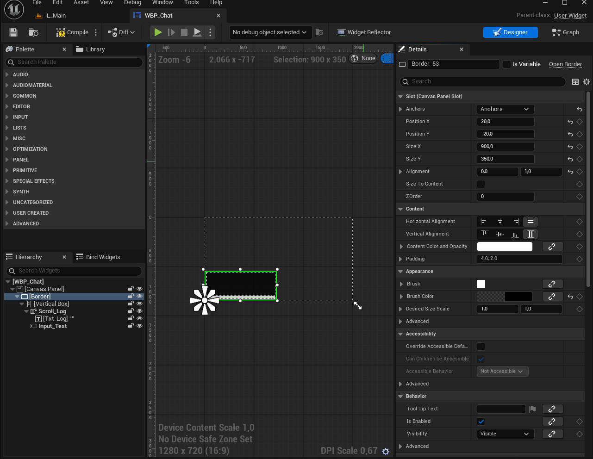

**Step 2 · Layout containers**

1. Drag **Vertical Box** onto `Border`.
2. Drag **Scroll Box** onto `VerticalBox`. Select it, press F2 and rename it `Scroll_Log`. In Details tick **Is Variable** (top). Under **Slot (Vertical Box Slot) → Size** choose **Fill**.
3. Drag **Text Box** onto `VerticalBox`, *below* `Scroll_Log` (not inside it). Rename it `Input_Text`, tick **Is Variable**. Use **Text Box**, not *Editable Text* and not the *Multi-Line* versions.

**Step 3 · The log text**

1. Drag **Text** onto `Scroll_Log`. Rename it `Txt_Log`, tick **Is Variable**.
2. Details: **Text** empty (delete the default text); **Appearance → Font → Size** `24`; **Color and Opacity** white; **Wrapping → Auto Wrap Text** on.

**Step 4 · The input box**

Select `Input_Text`. **Font → Size** `24`. **Hint Text**: `Type a request...`. Under **Behavior**, turn **Clear Keyboard Focus On Commit** **off** (otherwise the box loses focus after every Enter).

### Part B · Graph

Switch to the **Graph** tab.

**Step 5 · Function `AddLine`** (appends a line to the log: *new text = old text + line break + new line*)

1. *My Blueprint* → **Functions → +** → name it `AddLine`, Enter. A graph with a purple entry node **AddLine** opens.
2. Click the purple node. In Details: **Inputs → +** → name `Line`, type **Text**.
3. Right-click an empty spot → `Format Text` → click it. In the **Format** field type `{0}`, press **Shift+Enter** (new line inside the field), type `{1}`, click outside. The node now has pins **0** and **1**.
4. Drag `Txt_Log` from *My Blueprint → Variables* onto the graph → **Get Txt_Log**. 
5. `from Get Txt_Log → add GetText (Text)`. If the search does not find it, type `Get Text`. **This node is required**: wiring `Get Txt_Log` straight into pin **0** makes Unreal convert the *widget object* to text, and the log would show the word `Txt_Log` instead of the old content (the log would then never accumulate lines).
6. `wire GetText.Return Value → Format Text.0`.
7. `wire AddLine.Line → Format Text.1`.
8. Drag `Txt_Log` onto the graph again → **Get Txt_Log**. Drag a wire from its output pin to an empty spot. In the menu **untick Context Sensitive** (top right), type `Set Text` and choose the pink **Set Text** under *Class → Text*. Its **Target** is connected to `Get Txt_Log` automatically.
9. `wire Format Text.Result → Set Text.In Text`.
10. `wire` (white) `AddLine` entry → **Set Text**.
11. Drag `Scroll_Log` onto the graph → **Get Scroll_Log**. `from Set Text (white output) → add Scroll To End`. `wire Get Scroll_Log → Scroll To End.Target`.

Result: `AddLine ▶ Set Text ▶ Scroll To End`, with `Format Text` (fed by `GetText` and `Line`) providing the **In Text** of Set Text.

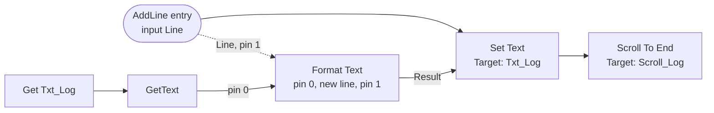

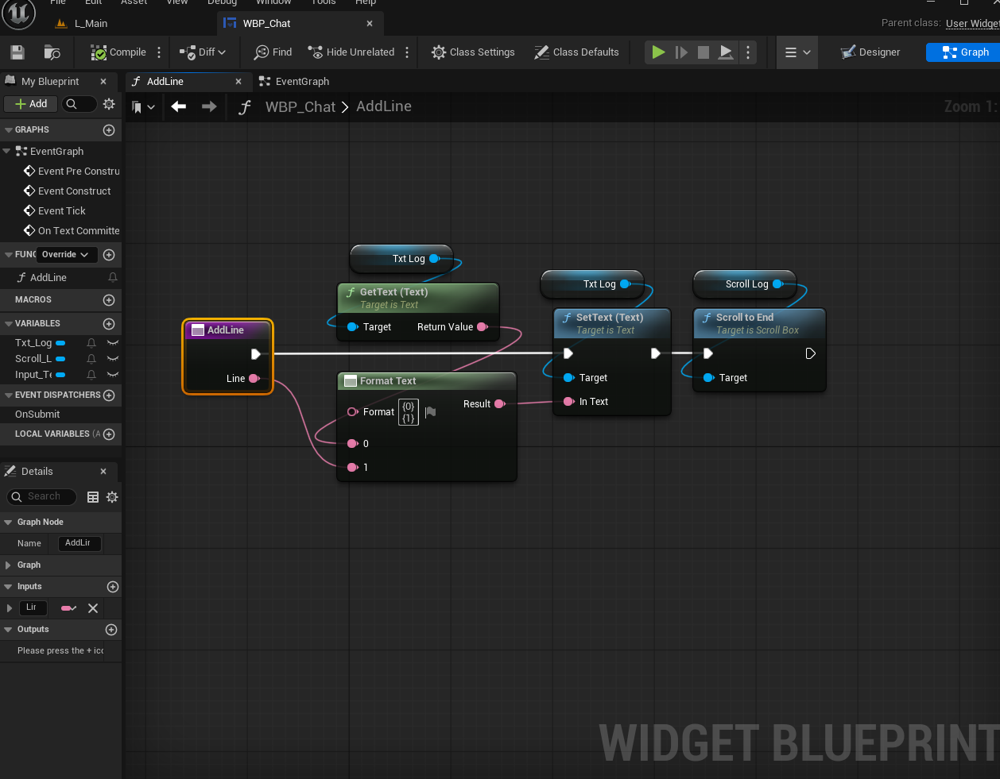

**Step 6 · Event dispatcher `OnSubmit`** (the "bell" the client will listen to)

1. *My Blueprint* → **Event Dispatchers → +** → name `OnSubmit`, Enter.
2. Select `OnSubmit`. Details: **Inputs → +** → name `Msg`, type **String**.

**Step 7 · What happens when the user presses Enter**

1. Tab **Designer** → select `Input_Text` in the Hierarchy → Details → scroll to **Events** → click **+** next to **On Text Committed**. The Graph opens with a red event node **On Text Committed (Input_Text)** with pins **Text** and **Commit Method**.
2. `from On Text Committed (white output) → add Branch`.
3. `from Commit Method → add Equal (Enum)` (choose *Equal (Enum)*). Set its second input, a drop-down, to **On Enter**. `wire Equal (Enum) output → Branch.Condition`.
4. Drag `OnSubmit` from *Event Dispatchers* onto the graph → choose **Call**. `wire` (white) **Branch.True → Call OnSubmit**.
5. `wire On Text Committed.Text → Call OnSubmit.Msg` (Unreal inserts a Text → String conversion).
6. Drag `Input_Text` onto the graph → **Get Input_Text**. Drag a wire from its output pin to an empty spot. In the menu **untick Context Sensitive** (top right), type `Set Text` and choose the pink **Set Text** under *Class → Text Box*. Its **Target** is connected to `Get Input_Text` automatically. Leave **Text** empty: that is what clears the box. `wire` (white) **Call OnSubmit → Set Text**.

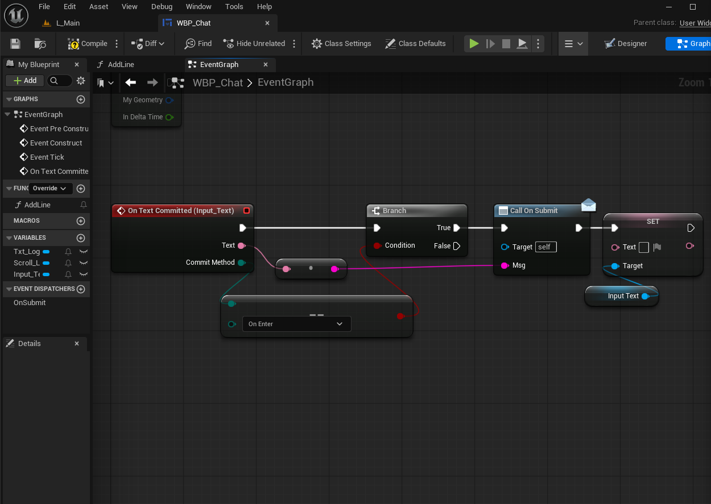

**Step 8 · At start-up**

1. In the Graph tab, find the node **Event Construct**: a new widget already has one, greyed out because nothing is wired to it yet. Use it. If it is not there, right-click an empty spot → `Event Construct` → click it.
2. `from Event Construct (white output) → add AddLine` (the function of Step 5). In its **Line** field type `Type a request, for example "make the cube red".`
3. `from AddLine (white output) → add Set Keyboard Focus`. Drag `Input_Text` onto the graph → **Get Input_Text** → `wire Get Input_Text → Set Keyboard Focus.Target`.

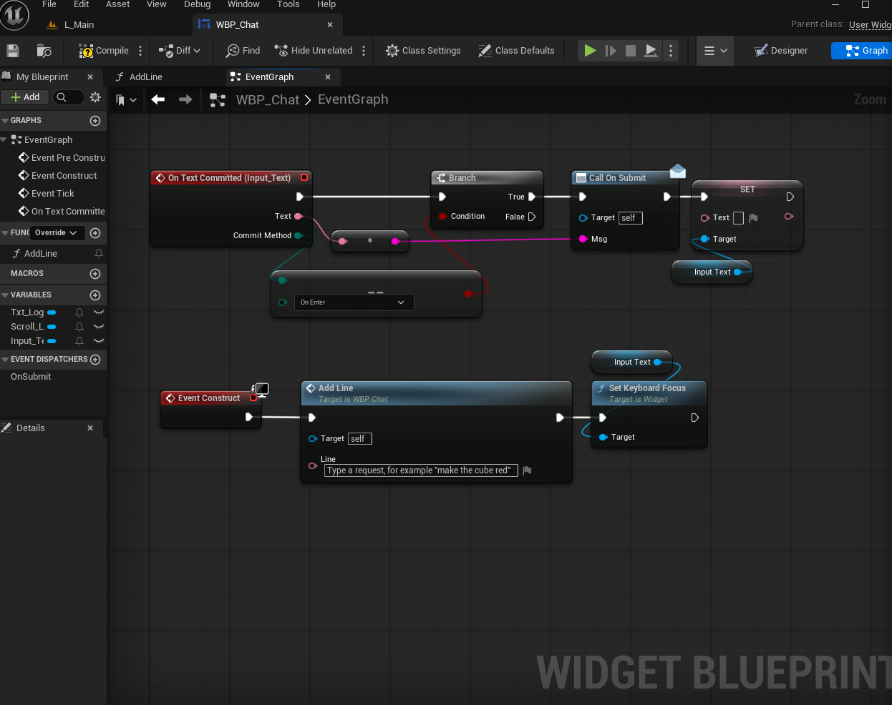

**Step 9 · Compile, Save.**

Three groups of nodes exist now:

- `AddLine ▶ Set Text ▶ Scroll To End` (with `Format Text` and `GetText`);
- `On Text Committed ▶ Branch (Commit Method = On Enter) ▶ True: Call OnSubmit ▶ Set Text (empty)`;
- `Event Construct ▶ AddLine ▶ Set Keyboard Focus`.

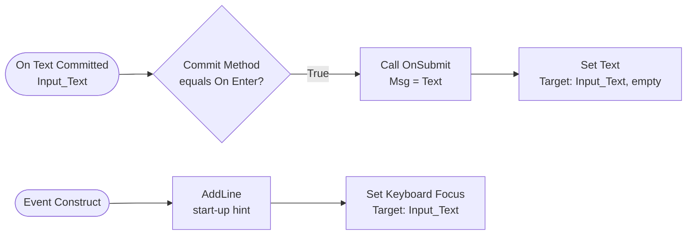

### Checkpoint 6.1

- [ ] Compile shows the green check, no red errors.
- [ ] In the Designer preview the dark panel sits at the bottom left, not over the whole screen.
- [ ] In `AddLine`, pin **0** of Format Text is fed by **GetText**, not directly by `Get Txt_Log`.

---

## 6.2 `BP_ColorCube`: the cube that changes colour

**What it is.** The cube gets a function `ApplyAction(Id)`. Depending on `Id` (`cube_red`, …) it sets the `Color` parameter of its material. The change is made on a *Material Instance Dynamic* (a run-time copy of the material), created at start and kept in the variable `Mat`.

Open `BP_ColorCube` (double-click in `Content/ColorCubeChat`) and select the **Event Graph** tab.

**Step 1 · Variable `Mat`**

1. *My Blueprint* → **Variables → +** → name `Mat`.
2. Details → **Variable Type** → in the search box type `Material Instance Dynamic` → choose **Material Instance Dynamic → Object Reference**.

**Step 2 · At start, create the copy of the material**

1. In the Event Graph find the node `Event BeginPlay` (if it is not there right-click, type the name, click it).
2. Drag the `Mesh` component from the **Components** panel onto the graph and choose **Get Mesh**.
3. `from Mesh → add Create Dynamic Material Instance`. **Element Index** stays `0`; **Source Material** stays **empty** (it takes the material already assigned to the cube).
4. `wire` (white) **Event BeginPlay → Create Dynamic Material Instance**.
5. Drag `Mat` onto the graph → **Set Mat**. `wire` (white) **Create Dynamic Material Instance → Set Mat**. `wire Create Dynamic Material Instance.Return Value → Set Mat.Mat`.

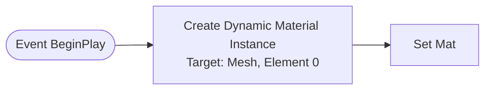

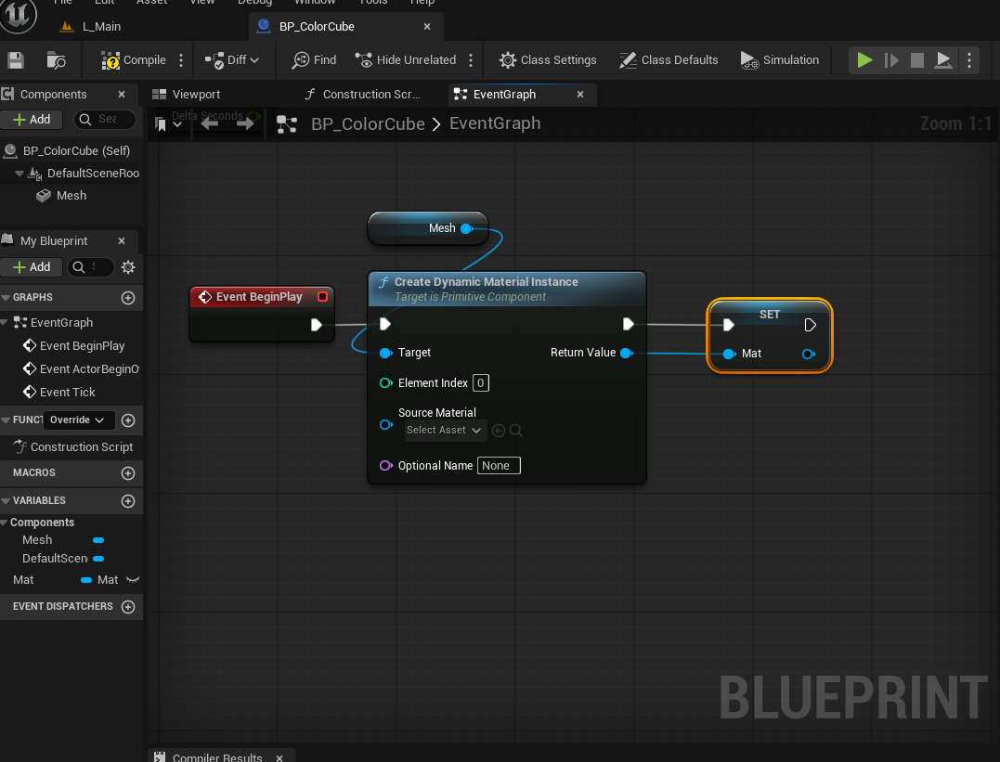

**Step 3 · Function `ApplyAction`**

1. *My Blueprint* → **Functions → +** → name `ApplyAction`, Enter. A purple entry node opens.
2. Click the purple node. Details → **Inputs → +** → name `Id`, type **String**.
3. Right-click an empty spot → `Switch on String` → click it. `wire` (white) the purple node → **Switch on String**. `wire Id → Switch on String.Selection`.
4. Click **Switch on String**. In Details, under **Pin Names**, click **+** four times and type: `cube_red`, `cube_green`, `cube_blue`, `cube_white`. The node shows four outputs with these names plus **Default** (leave Default unconnected).

**Step 4 · The red branch**

1. Drag `Mat` onto the graph → **Get Mat**.
2. `from Get Mat → add Set Vector Parameter Value` (category *Material Instance Dynamic*). **Target** is connected automatically.
3. **Parameter Name**: `Color` (capital C, as in the material).
4. Click the swatch of **Value** and set R 1, G 0, B 0, A 1 (values 0–1).
5. `wire` (white) **Switch on String.cube_red → Set Vector Parameter Value**.

**Step 5 · The other three colours**

1. Select **Get Mat** and **Set Vector Parameter Value** together (hold Ctrl and click both), Ctrl+C, then Ctrl+V three times. Each pair stays wired internally.
2. Wire each pair's white input to one of the other outputs of **Switch on String** and set **Value**:
   - `cube_green`: R 0, G 1, B 0;
   - `cube_blue`: R 0, G 0, B 1;
   - `cube_white`: R 1, G 1, B 1.

   Alpha is 1 in all four. In every copy check that **Parameter Name** is `Color`.

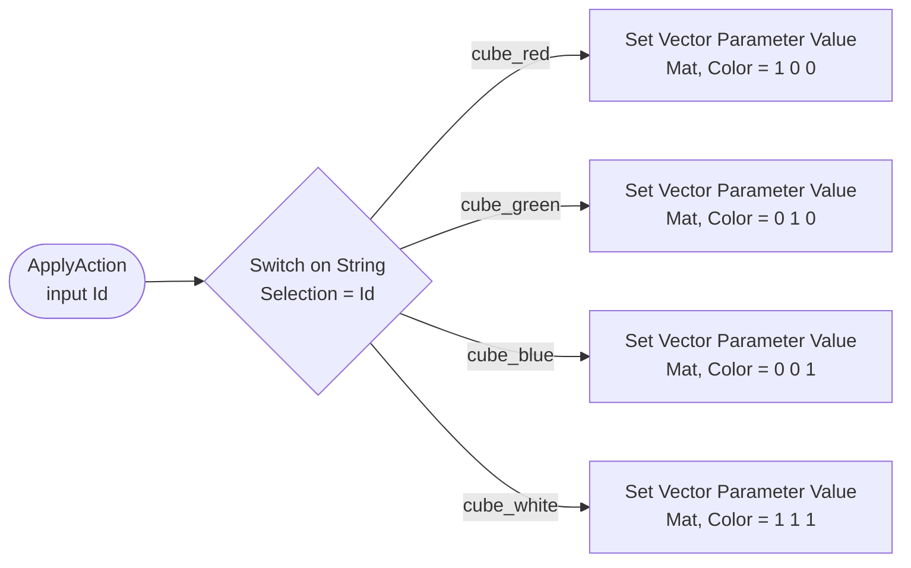

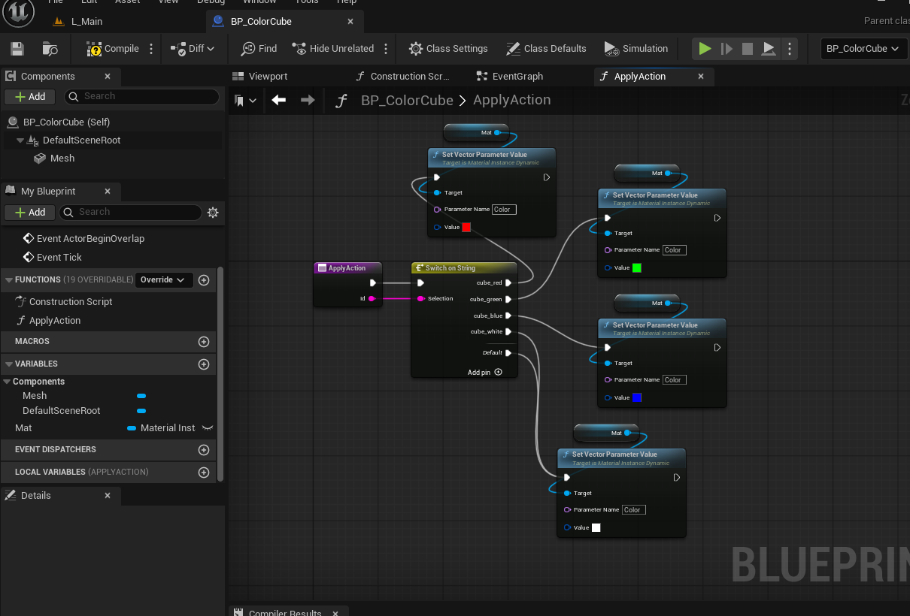

**Step 6 · Compile, Save.**

### Checkpoint 6.2: quick test without the server

1. In the **Event Graph**, after **Set Mat** add a call to **ApplyAction** (drag the function from *My Blueprint → Functions*) with `cube_red` in **Id**. `wire` (white) **Set Mat → ApplyAction**.
2. Compile, Save. In the main editor toolbar open the menu next to **Play** and choose **Standalone Game**. The cube must be **red**. Close with **Shift+F1** or close the game window.
3. **Delete the ApplyAction node from the Event Graph**, Compile, Save. At start the cube must be white again.

If the cube stays white: **Parameter Name** must be exactly `Color`; the white wire must run through **Set Mat → ApplyAction**; **Source Material** of *Create Dynamic Material Instance* must be empty.

---

## 6.3 `BP_AgentClient`: the connection to the server

**What it is.** An Actor placed in the level. At start it shows the chat. When the user submits a sentence it sends it to the server; when the server answers it changes the cube and writes the reply in the chat.

Create it: Content Browser → `Content/ColorCubeChat` → right-click → **Blueprint Class → Actor** → name `BP_AgentClient`. Open it, tab **Event Graph**.

The graph has three groups of nodes, each starting from its own red node: **Part A**, **Part B** and **Part C**. At the end of each part a diagram shows what the finished group looks like; Compile and Save there.

### Part A · At start (`Event BeginPlay`)

**Step 1 · Variables**

Create three variables. For each one: *My Blueprint* → **Variables → +**, type the name, then in **Details** click the **Variable Type** drop-down, type the name of the type in its search box and, from the drop-down of the result, choose **Object Reference**.

1. `Cube`, type `BP_ColorCube` →**Object Reference** .
2. `Req`, type `VaRest Request JSON` →**Object Reference**.
3. `Chat`, type `WBP_Chat` →**Object Reference**.

**N.B.** If you cannot find one of these types in the search, skip that variable and create it later, when you reach the step that uses it, from the node that produces it: right-click the output pin of that node (for example **Return Value** of **Create Widget**) → **Promote to Variable** → type the name → Enter. Unreal creates the variable and its **Set** node, already wired.

**Step 2 · Create Widget and the variable `Chat`**

1. Create `Event BeginPlay` if it is not there.
2. `from Event BeginPlay (white output) → add Create Widget`. In its **Class** drop-down choose `WBP_Chat`.
3. `from Create Widget.Owning Player → add Get Player Controller` (Player Index 0). This node is also used in Steps 4 and 5: do not create another.
4. Drag `Chat` onto the graph → **Set Chat**. `wire` (white) **Create Widget → Set Chat**, and `wire Create Widget.Return Value → Set Chat.Chat`.

**Step 3 · Add to Viewport** (shows the chat)

1. `from Set Chat (white output) → add Add to Viewport`.
2. `wire Set Chat output pin (blue) → Add to Viewport.Target`.

**Step 4 · Set Input Mode UI Only**

1. `from Add to Viewport (white output) → add Set Input Mode UI Only`.
2. `wire Get Player Controller.Return Value → Set Input Mode UI Only.Player Controller`.
3. Leave **In Widget to Focus** and **In Mouse Lock Mode** as they are. **Do not** wire `Chat` to *In Widget to Focus*: Unreal reports *Attempting to focus Non-Focusable widget*. The focus is already given by `Set Keyboard Focus` in `WBP_Chat`.

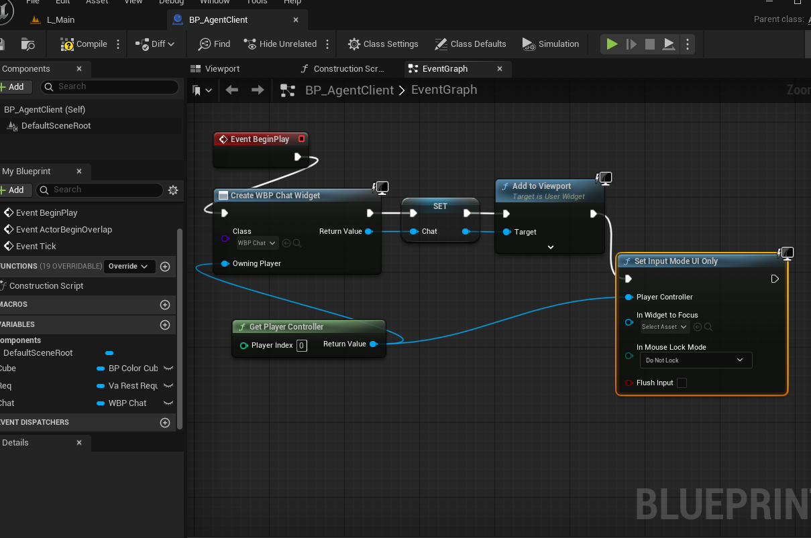

**Step 5 · Set Show Mouse Cursor**

1. `from Set Input Mode UI Only (white output) → add Set Show Mouse Cursor`.
2. `wire Get Player Controller.Return Value → Set Show Mouse Cursor.Target`.
3. Tick **Show Mouse Cursor** on that node.

**Step 6 · Get Actor Of Class and Set Cube**

1. `from Set Show Mouse Cursor (white output) → add Get Actor Of Class`. In **Actor Class** choose `BP_ColorCube`.
2. Drag `Cube` onto the graph → **Set Cube**.
3. `wire` (white) **Get Actor Of Class → Set Cube**.
4. `wire Get Actor Of Class.Return Value → Set Cube.Cube`. If Unreal says the types do not match: delete **Set Cube**, drag a wire from **Return Value** to an empty spot and type `Set Cube`; it inserts the cast itself.

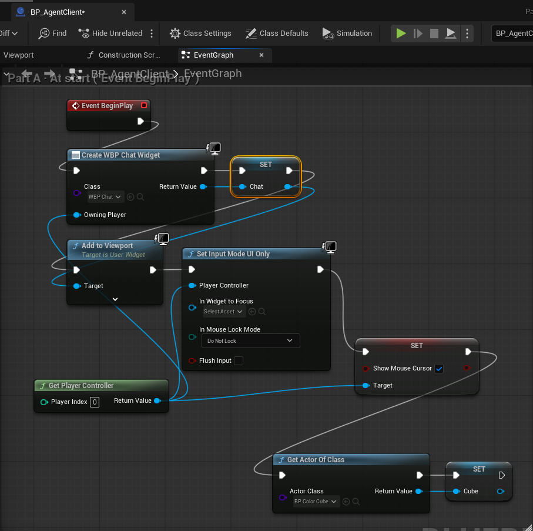

**Step 7 · Listen to the chat: Bind Event to On Submit**

1. Drag a wire from the blue output pin of **Set Chat** to an empty spot, type `Assign On Submit`, click it. **Unreal creates two nodes** (normal): **Bind Event to On Submit**, with its **Target** wired to the blue pin of **Set Chat**, and a red **Custom Event** wired to the red **Event** pin of the Bind node. The custom event has a pin **Msg**.
2. The red node asks for a name: type `SendQuery`, Enter. (If it does not ask, click the red node and type `SendQuery` in **Name** in Details.) Do not add any other event.
3. Unreal usually wires the white pin of **Set Chat** to the Bind node by itself, and this can pull the wire away from **Add to Viewport**. Fix both ends: the white output of **Set Chat** goes only to **Add to Viewport** (delete the wire to the Bind node, and re-wire Add to Viewport if it lost its input), and `wire` (white) **Set Cube → Bind Event to On Submit**.
4. The red **SendQuery** node has no incoming white wire: it runs by itself when the chat raises `OnSubmit`. Part B continues from it.

Part A is finished when your graph matches this (solid lines are white execution wires, dotted lines are data or event connections):

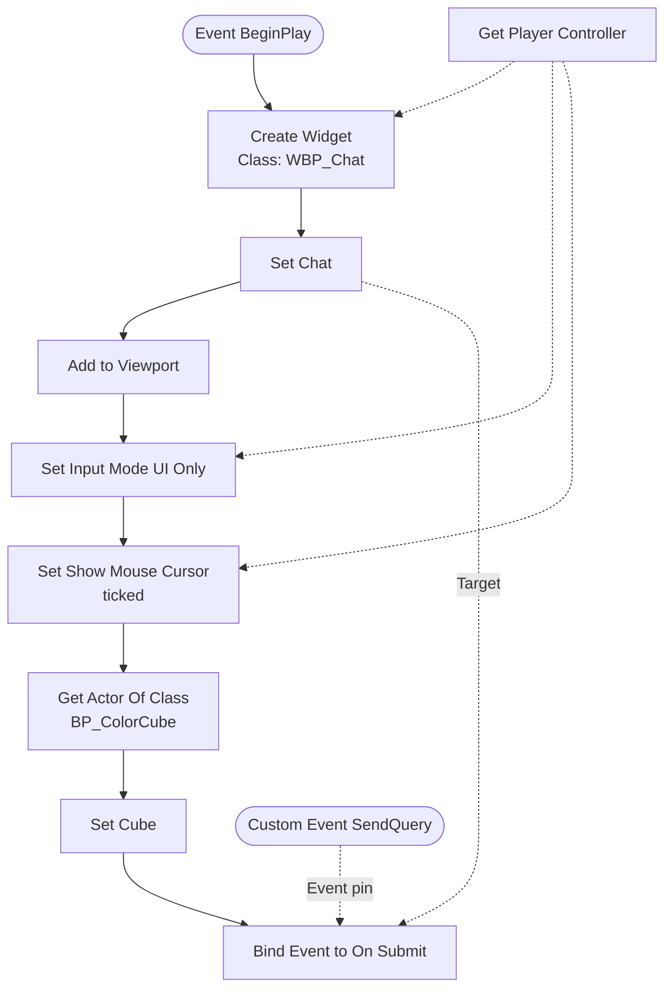

**Compile, Save.**

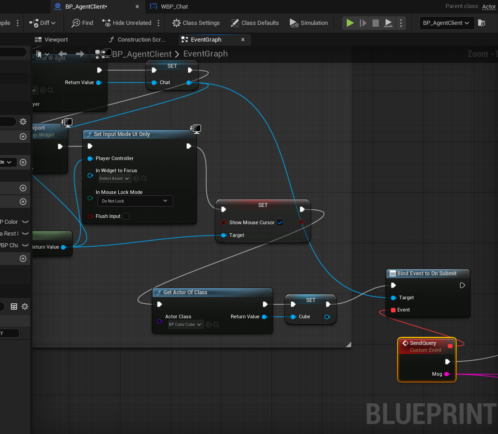

### Part B · When the user submits a sentence (red node `SendQuery`)

**Step 8 · Write `You: …` in the chat**

1. Drag `Chat` onto the graph → **Get Chat**.
2. `from Get Chat → add AddLine`.
3. `wire` (white) **SendQuery → AddLine**. 

   > **This is the wire most often forgotten.** If the white output pin of the red `SendQuery` node is not connected, nothing after it ever runs: no `You:` line, no request to the server, no error. After this step the red node must have a wire leaving its white output pin.

4. `from AddLine.Line → add Append` (the string one). A small conversion node between them is fine.
5. In pin **A** of Append type `You: ` (with a space after the colon). `wire SendQuery.Msg → Append.B`.

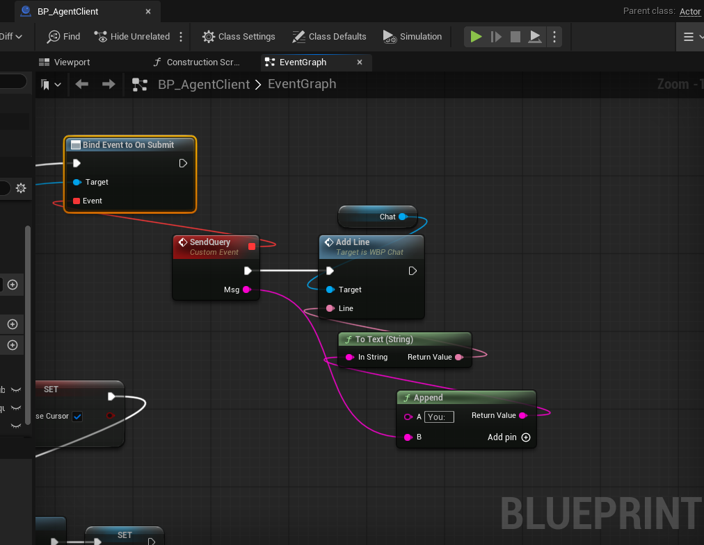

**Step 9 · Create the request**

1. Right-click an empty spot → `Get VaRest Subsystem` → click it. One node, no white pins, one output. One is enough. (Without it, Compile reports *is not a VaRestSubsystem, Target must have a connection*.)
2. `from AddLine (white output) → add Construct Json Request`. Pick the one named exactly `Construct Json Request` (it has pins **Verb** and **Content Type**), **not** `Construct Json Request (Empty)`.
3. `wire Get VaRest Subsystem output → Construct Json Request.Target`.
4. On `Construct Json Request` set **Verb** `POST` and **Content Type** `json`.
5. Drag `Req` onto the graph → **Set Req**. `wire` (white) **Construct Json Request → Set Req**. `wire Construct Json Request.Return Value → Set Req.Req`.

**Step 10 · Build the JSON body** `{"text": "<the sentence>"}`

1. `from Set Req (white output) → add Construct Json Object`.
2. `wire Get VaRest Subsystem output → Construct Json Object.Target` (the second wire from that pin).
3. `from Construct Json Object (white output) → add Set String Field`.
4. `wire Construct Json Object.Return Value → Set String Field.Target`.
5. On `Set String Field`: **Field Name** `text` (lowercase). `wire SendQuery.Msg → Set String Field.String Value`.

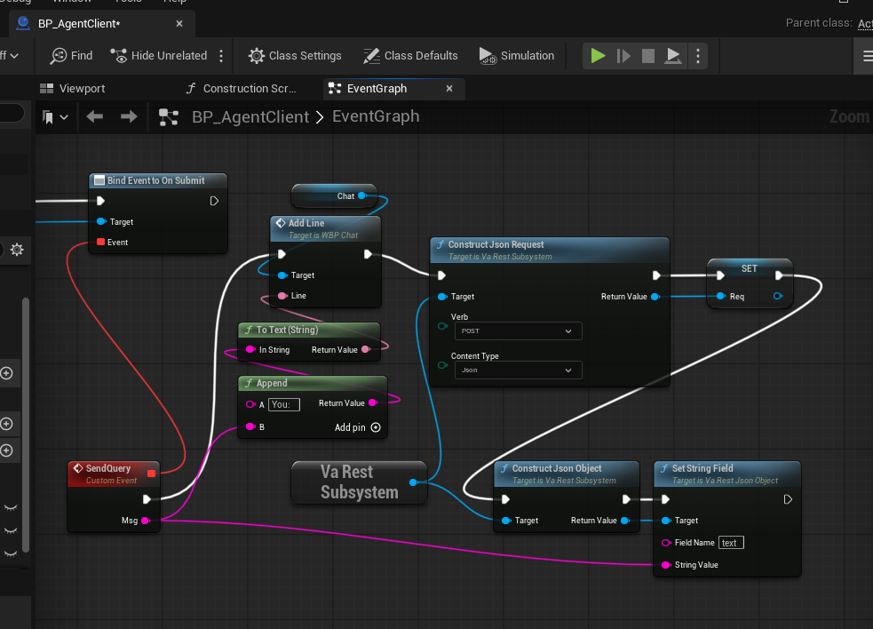

**Step 11 · Put the body into the request** (exactly one `Set Request Object`)

1. `from Set String Field (white output) → add Set Request Object`.
2. `wire Set Req output pin (blue) → Set Request Object.Target`.
3. `wire Construct Json Object.Return Value → Set Request Object.Json Object` (the second wire from that pin).

**Step 12 · If an answer arrives: event `OnOk`**

1. Drag a wire from the blue output of **Set Req** to an empty spot, type `Assign On Request Complete`, click it. As in Step 7, **two nodes** appear: **Bind Event to On Request Complete** (Target wired) and a red Custom Event.
2. Name the red node `OnOk`, Enter. It has a pin **Request**.
3. `wire` (white) **Set Request Object → Bind Event to On Request Complete**.

**Step 13 · If no answer arrives: event `OnFail`**

1. Drag a wire from the blue output of **Set Req** to an empty spot, type `Assign On Request Fail`, click it. Two nodes appear: **Bind Event to On Request Fail** and a red Custom Event.
2. Name the red node `OnFail`, Enter.
3. `wire` (white) **Bind Event to On Request Complete → Bind Event to On Request Fail**.

**Step 14 · Send (last node, after the two binds)**

1. `from Set Req output pin (blue) → add Process URL`.
2. `wire` (white) **Bind Event to On Request Fail → Process URL**.
3. In **URL** type `http://127.0.0.1:8000/query` (with `127.0.0.1`, not `localhost`).

Part B is finished when your graph matches this:

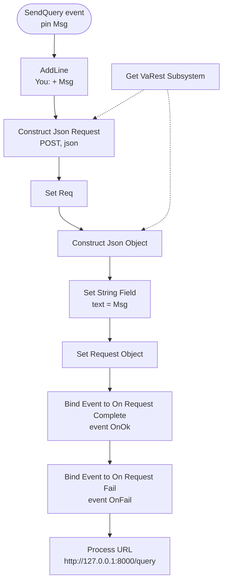

**Compile, Save.**

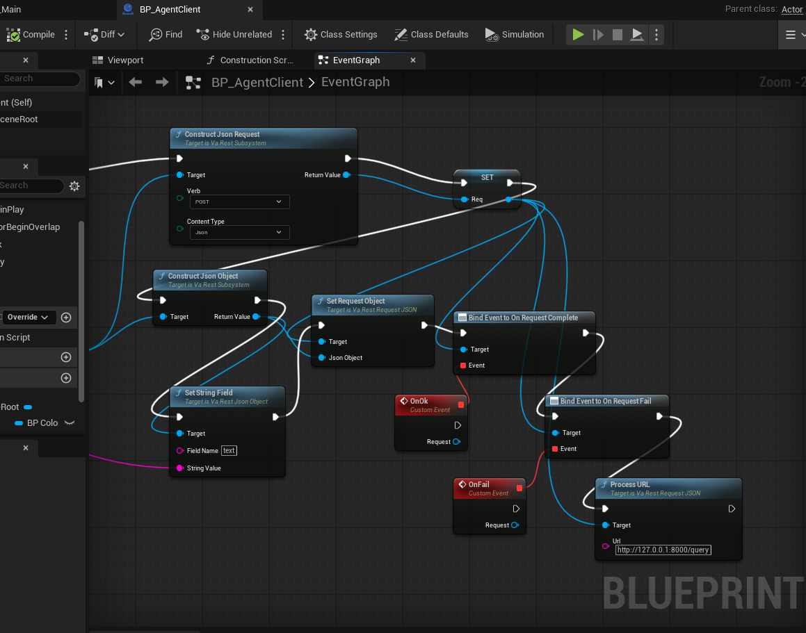

### Part C · When the server answers

Part C uses three `Get String Field` nodes. Below they are written *(status)*, *(id)* and *(reply)*; on the graph all three are called `Get String Field` and differ only by their **Field Name**.

**Step 15 · Event `OnOk`: read `status`**

1. `from OnOk.Request → add Get Response Object`.
2. `from Get Response Object.Return Value → add Get String Field`. **Field Name** `status`. This is *(status)*.
3. `from Get String Field (status) Return Value → add Switch on String`. Its **Selection** is already wired.
4. Click **Switch on String**. In Details → **Pin Names**, click **+** three times: `ok`, `ambiguous`, `out_of_scope`. The node also has a **Default** output.
5. `wire` (white) **OnOk → Switch on String**. (*Get Response Object* and *Get String Field* are pure nodes without white pins, so the execution path is simply `OnOk → Switch on String`.)

**Step 16 · Output `ok`: change the cube and write the reply**

1. `from Get Response Object.Return Value → add Get String Field`. **Field Name** `id`. This is *(id)*.
2. Drag `Cube` onto the graph → **Get Cube**. `from Get Cube → add ApplyAction`.
3. `wire Get String Field (id) Return Value → ApplyAction.Id`.
4. `wire` (white) **Switch on String.ok → ApplyAction**.
5. `from Get Response Object.Return Value → add Get String Field`. **Field Name** `reply`. This is *(reply)*.
6. Drag `Chat` onto the graph → **Get Chat**. `from Get Chat → add AddLine`.
7. `wire` (white) **ApplyAction → AddLine**.
8. `from AddLine.Line → add Append`. In pin **A** type `System: ` (with a space). `wire Get String Field (reply) Return Value → Append.B`.

**Step 17 · Output `ambiguous`**

1. Drag `Chat` → **Get Chat**; `from Get Chat → add AddLine`.
2. `wire` (white) **Switch on String.ambiguous → AddLine**.
3. In **Line** type `System: I'm not sure what you mean, can you rephrase?`

**Step 18 · Outputs `out_of_scope` and `Default`**

1. Drag `Chat` → **Get Chat**; `from Get Chat → add AddLine`.
2. Two white wires into the same **AddLine**: **Switch on String.out_of_scope → AddLine** and **Switch on String.Default → AddLine**.
3. In **Line** type `System: I can't do that here.`

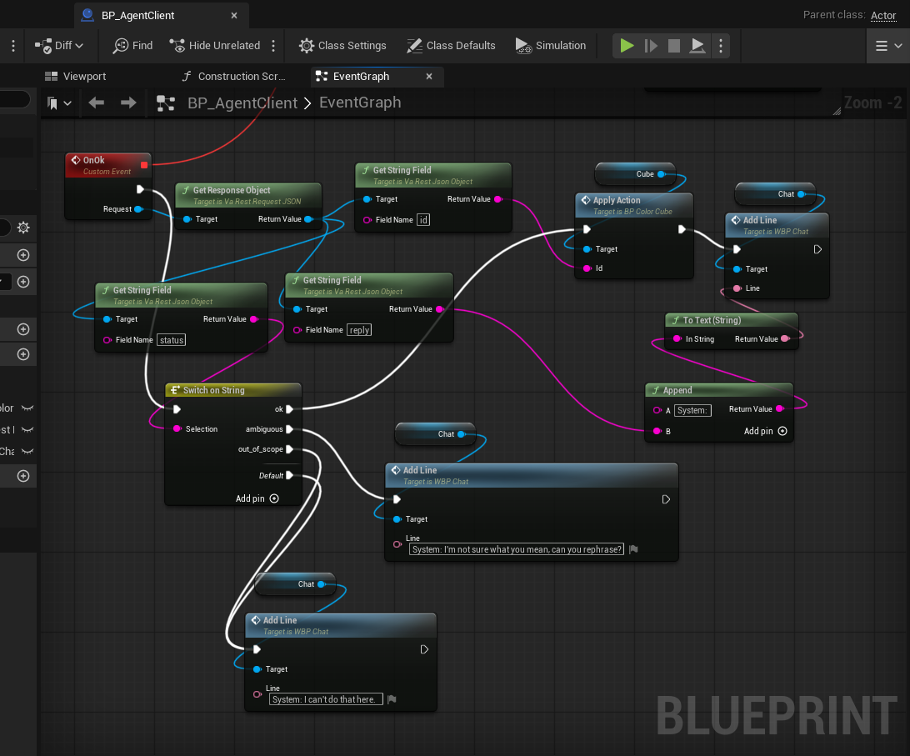

**Step 19 · Event `OnFail`**

1. Drag `Chat` → **Get Chat**; `from Get Chat → add AddLine`.
2. `wire` (white) **OnFail → AddLine**.
3. In **Line** type `System: The assistant is not responding.`

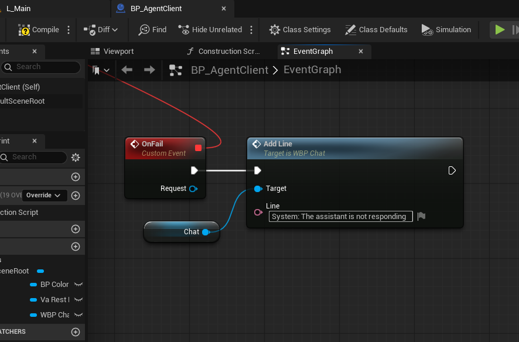

Part C is finished when your graph matches this:

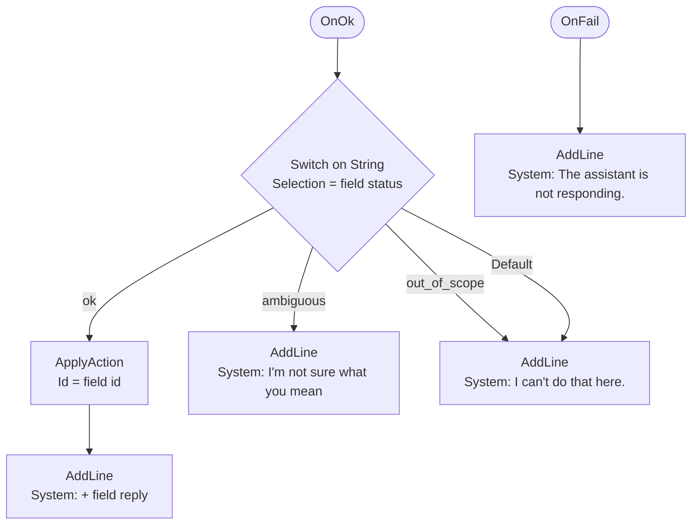

**Step 20 · Compile, Save.**

**Do not branch on *Get Status*** (see [03](03-varest-plugin.md#a-known-defect-do-not-branch-on-get-status)). The graph uses only `OnOk` and `OnFail`.

### Checkpoint 6.3: read the wires before running

Follow each white line with your finger.

- [ ] Every white wire shown in the diagrams of Parts A, B and C exists in your graph, with no break.
- [ ] `Set String Field.Field Name` = `text`; its **String Value** comes from `SendQuery.Msg`.
- [ ] `Process URL.URL` = `http://127.0.0.1:8000/query`; its **Target** is `Req`.
- [ ] The three `Get String Field` have the **Field Name** `status`, `id`, `reply` (lowercase).
- [ ] Compile: green check on `WBP_Chat`, `BP_ColorCube`, `BP_AgentClient`. **File → Save All** (Ctrl+Shift+S).

---

## 6.4 Place the client and run

1. Drag `BP_AgentClient` from the Content Browser into the level. Its position does not matter. There must be **exactly one** `BP_AgentClient` and one `BP_ColorCube` in the level (check the Outliner).
2. **File → Save Current Level.**
3. Start the server ([04](04-python-server.md#43-start-the-server)) and wait for `Application startup complete.`
4. Open the menu next to **Play** → **Standalone Game**. A window opens with the cube on the floor and the dark chat panel at the bottom left. The first line reads `Type a request, for example "make the cube red".`
5. Type `make the cube red` and press Enter.

Expected:

- the chat shows, in order, `You: make the cube red` and `System: The cube is now red.`;
- the cube turns red;
- the server terminal shows a new `POST /query HTTP/1.1" 200 OK`.

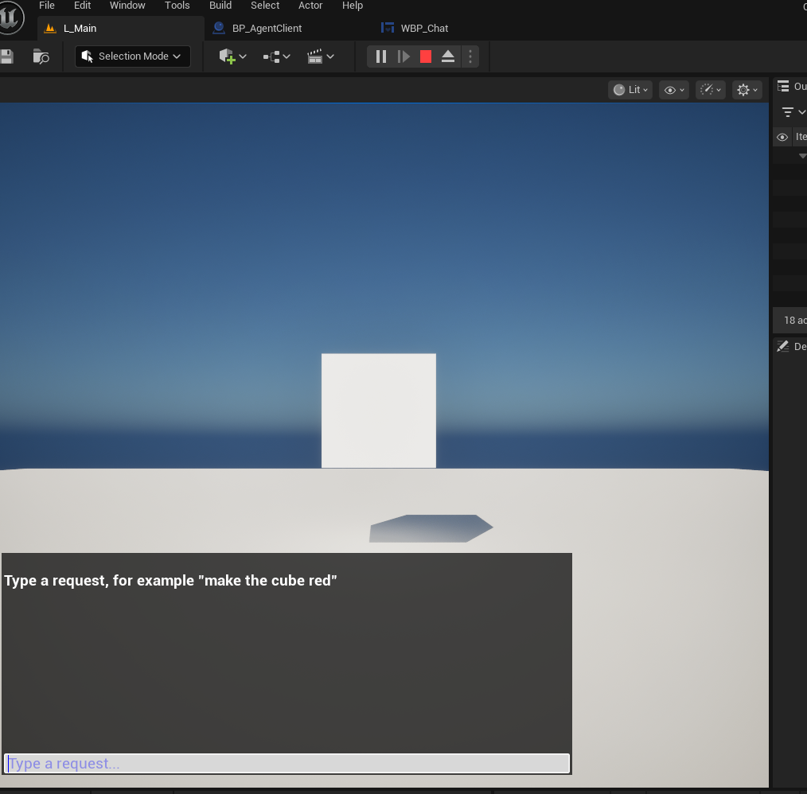


Close the game with **Shift+F1** (or close its window). Continue with [07 · Testing and debugging](07-test-and-debug.md) for the full test table and for what to do when a step does not produce the expected result.

---

## 6.5 Reference graphs: paste them into the editor

The folder [`docs/blueprints/`](blueprints/) holds the finished graphs of this chapter as text. It is the format Unreal puts on the clipboard when you select nodes and press Ctrl+C, so Ctrl+V in a graph recreates the nodes with their wires, values and comment boxes. Three uses: compare with your graph, recover a graph you got stuck on, skip a repetitive part.

| File | Graph it belongs to | Must exist before pasting | Do after pasting |
|---|---|---|---|
| `WBP_Chat_AddLine.txt` | `WBP_Chat` → function `AddLine` | The function `AddLine` with the input `Line` (Text). Widget variables `Txt_Log`, `Scroll_Log`. | Wire the white pin of the purple **AddLine** node to **SetText**, and its **Line** pin to pin **1** of **Format Text**. |
| `WBP_Chat_EventGraph.txt` | `WBP_Chat` → Graph tab, Event Graph | The dispatcher `OnSubmit(Msg: String)`; widget variables `Input_Text`, and `AddLine` from the file above. | Delete any existing **Event Construct** first. If the red **On Text Committed** node does not come with its binding, delete it and create it again as in Step 7.1, then wire it to the **Branch**. |
| `BP_ColorCube_EventGraph.txt` | `BP_ColorCube` → Event Graph | The variable `Mat` and the `Mesh` component. | Delete the default **Event BeginPlay** first. |
| `BP_ColorCube_ApplyAction.txt` | `BP_ColorCube` → function `ApplyAction` | The function with the input `Id` (String). | Wire the white pin of the purple **ApplyAction** node to **Switch on String**, and **Id** to its **Selection**. |
| `BP_AgentClient_EventGraph.txt` | `BP_AgentClient` → Event Graph | Variables `Cube`, `Req` and `Chat` (Step 1). `WBP_Chat` with its `AddLine` and `OnSubmit`, `BP_ColorCube` with `ApplyAction`. | Delete the default **Event BeginPlay** first. Nothing to wire. |

**How to paste**

1. Open the `.txt` file in a plain text editor, select all, copy.
2. Open the Blueprint and the right graph (the Event Graph tab, or double-click the function in *My Blueprint*).
3. Click an empty spot in the graph (the nodes appear at the mouse position) and press **Ctrl+V**.
4. Do the wiring from the last column of the table, then **Compile**.

**Notes**

- The asset names and folders of [02](02-unreal-project.md) are assumed (`/Game/ColorCubeChat/WBP_Chat`, `BP_ColorCube`, …). With other names, nodes that point to them show red errors.
- The purple entry node of a function cannot be pasted (Unreal does not allow it), hence the two wires to add by hand for the functions.
- Unreal ignores a pasted event that already exists in the graph, which is why the default **Event BeginPlay** has to go first.
- These files were generated from a finished project by a script. **Pasting them has not been tested**: if a paste produces nothing or red nodes, build the graph by hand with the steps above and use the file only to compare.
